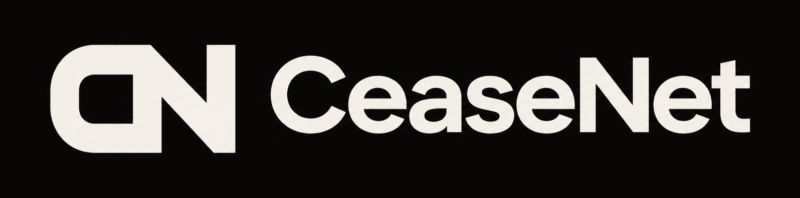

<p align="center">
  
</p>

<h3 align="center">Recalls for AI agents</h3>

<p align="center">
  Stop your agents from anywhere, recall a bad tool everywhere it runs, and see exactly what they did.<br>
  Nobody but an agent's owner can stop it, and nothing we run can keep the owner from stopping it.
</p>

<p align="center">
  <a href="https://ceasenet.vercel.app/"><strong>Live site</strong></a> · <a href="#start">Get started</a> · <a href="#how-it-works">How it works</a> · <a href="#open-source-build-on-it-or-replace-us">Build on it</a> · <a href="#crops">CROPS</a> · <a href="#what-this-does-not-do">What this does not do</a>
</p>

<p align="center">
  <a href="https://github.com/GuTS805/CeaseNet/actions/workflows/test.yml"></a>
  <a href="LICENSE"></a>
</p>

## In one minute

**The problem.** In September 2025, an email tool for AI agents on npm started quietly copying every email it sent to an attacker. It was taken down, but agents that already had it kept running it, because nothing can tell a running agent to stop.

**What CeaseNet does.** One command, `ceasenet protect`, puts a gate between your agents and their tools, with no change to either. Before every call, the gate reads a public recall list on [Arkiv](https://arkiv.network). Press Stop, from any machine, and the next call is refused, the agent is told why, and the tool's process is ended. Every call also goes in a diary that nobody can quietly change.

```
  your agent ──▶ CeaseNet gate ──▶ its tools: MCP servers, and Claude Code's own Bash and file edits
                      │  asks before every call
                      ▼
  Arkiv: STOPs signed by the agent's owner, and public receipts showing each agent obeyed
```

**Why you can rely on it**

- **Only the owner counts.** A gate obeys only a STOP signed by its owner's wallet, and the chain records who signed each record, so nobody can fake it. A STOP from anyone else, us included, changes nothing.
- **Nothing of ours is in the path.** Each gate reads Arkiv itself, so an owner's STOP keeps working if our site, our server and this repository all disappear.
- **It fails closed.** If a gate can't read the list, its agent keeps working for 5 minutes, then asks a person before each call, then refuses.
- **It works with what you already use.** `protect` covers the MCP tools of Claude Code, Claude Desktop, Cursor, VS Code, Windsurf and Gemini CLI. It runs on test networks today.

### For judges

| Prize | What to look at | Where |
|---|---|---|
| **Ethereum Foundation: Best CROPS app** | The lead property is censorship resistance. A second gate in Python, written from the spec with none of our code, passes the same 56 cases as ours, and every part we run has a stated replacement | [CROPS](#crops), [Build on it](#open-source-build-on-it-or-replace-us) |
| **Arkiv** | Arkiv is the recall list itself. Every gate decides from what it reads there, and authority comes only from who signed a record | [How we use Arkiv](arkiv/how-you-use-arkiv.md), [the schema](arkiv/schema.md), and `npm run query`, which needs no key |
| **Arkiv + Swarm** | Each agent's diary is encrypted to its owner and kept on Swarm, with its index and hash on Arkiv. A copy of the site lives on Swarm too | [arkiv/swarm.md](arkiv/swarm.md) |
| **World** | Log in with World: one real person per wallet, so votes on a recall count people, not wallets. Votes alone never stop an agent, because its owner decides | [docs/world.md](docs/world.md). Logging in with World App works on the hosted site, and nothing else logs you in there |

To try it with no wallet and nothing public, see [Start](#start) and use `ceasenet init --local`. The [live site](https://ceasenet.vercel.app/) reads Arkiv from your browser, with no account.

In the run below, three real AI trading agents closed themselves 35 to 97 milliseconds after Recall was pressed, reading this machine's list. On the public list it takes about 5 seconds, while the STOP's transaction confirms. Their money is paper.


## Start

You need Node 22.10 or newer.

```bash
npm install -g ceasenet    # the program, from npm

ceasenet init              # creates this agent's identity, and yours as its owner. Add --local to keep everything on this machine
ceasenet protect           # puts the gate in front of your agents' tools
ceasenet console           # opens the console at http://127.0.0.1:7787
```

Then restart your agent's client and use it as usual. `protect` finds the settings of Claude Code, Claude Desktop, Cursor, VS Code, Windsurf and Gemini CLI, keeps a copy of each file it changes, and `ceasenet unprotect` undoes it. If PowerShell says running scripts is disabled, type `npm.cmd` instead of `npm`. To run the site, the verifier or the checks, clone this repository and run `npm install`.

On the public list, you can stop your agents from any machine. Writing to it needs free test tokens: [tGLM](https://hub.arkiv.network/faucet) for Arkiv and [0G tokens](https://faucet.0g.ai) for diaries, sent to the address `ceasenet init` prints. With `--local` nothing is public and nothing is needed, and `ceasenet network arkiv` moves you to the public list later. `ceasenet rpc <url>` reads through an Arkiv node you run, and `ceasenet import-settings .env` copies your model key and other settings. No tool ever sees them.

## See it work: three real AI trading agents

```bash
ceasenet agents start
ceasenet console
```

Three terminals open: a momentum trader, a mean-reversion trader and a risk watcher, each its own process with its own key. A real model decides each step on live Coinbase prices, through real MCP servers. **The money is paper:** each starts with $10,000 in a file in its folder, and no real funds exist to lose.


| On the Agents page, press | What happens |
|---|---|
| **Recall** on the market tool | All three use it, so all three close. Starting them again does nothing until it is lifted |
| **Recall** on the broker tool | The two traders close, and the risk watcher keeps working |
| **Stop this agent** or **Stop all three** | Only those close, and nothing else you run is affected |

Each card then shows how long closing took, that the system confirms the process has gone, and whether its receipt is on the list. The agents think with any model service that speaks the OpenAI chat API (Groq's free tier works), or with Claude Code if there is none. To record them on Windows, set `AGENT_TERMINALS="compact"` in `~/.ceasenet/.env`: their windows open small, in a column on the right of the screen, leaving room for a browser.

## Stop agents and recall tools

| You do this | From the console, or | What happens |
|---|---|---|
| **Stop an agent** | `ceasenet kill --reason "..."` | Every MCP tool call is refused and those tools' processes are ended. In Claude Code, its own tools such as Bash and file edits are refused too |
| **Stop all your agents** | `ceasenet kill --all --reason "..."` | The same, for every agent you own, on any machine |
| **Recall a tool** | `ceasenet stop some-tool@1.2.3 --reason "..."` | Only that tool is refused and ended, on every agent you own. An npm package recalled by name and version is never even downloaded |
| **Ask first** | `ceasenet hold some-tool` | Each call waits until you approve it at the console. With nobody answering, it does not run |
| **Undo it** | `ceasenet lift <key>` | What was stopped carries on, in the same session |
| **Stop an agent elsewhere** | `ceasenet init --owner 0x...` on that machine, `ceasenet enroll 0x...` on yours | Its gate obeys your key from wherever you are, and your key never goes near that machine |

`ceasenet help` lists everything, and `ceasenet status` shows what is protected and what is running.

## On the website

[The site](https://ceasenet.vercel.app/) reads Arkiv straight from your browser, with no account and no server of ours. To write, you need a browser wallet on the Rabdi testnet.

- **Network:** every agent, owner and recall on Arkiv, drawn live from the records, with no list of keys to start from.
- **Recalls** and **Check a tool:** the whole list, and a check of any tool against it that your browser does itself, so no node learns which tool you asked about.
- **Stop it as the owner:** the whole agent, or one tool on all your agents, signed by your own wallet. **Register an agent** the same way.
- **Open a recall** on anyone's agent or tool, after logging in with World.


A recall opened by someone who isn't the owner never stops anything by itself, because a crowd must not be able to switch off someone's agent:

1. **Log in with World.** Your wallet signs a message, and World ID shows a real, unique person is behind it, without saying who. The verifier writes a `ceasenet.human` record on Arkiv, and one person can link only one wallet.
2. **Open a recall, and others vote.** Each person counts once on each recall, and votes are public.
3. **At 3 votes, while votes for outnumber votes against, the owner decides.** Approving is one press, which is a STOP signed by the owner's own wallet, so their agents obey it within seconds.


The hosted site runs the verifier as a Vercel function, [api/verifier.mjs](api/verifier.mjs), built from [this source](apps/verifier/src/vercel.ts). `npm run verifier` runs your own. Logging in with World App works there, and the first real login is on Arkiv. To log out, press **Log out** on the login page, which disconnects the site from your wallet.

## Look back: what did that agent do?

Every call goes in the agent's diary: what was called, what came back, what the gate decided and what the model said. Each part is stored on [Swarm](arkiv/swarm.md), encrypted so only the owner can read it, or on [0G Storage](https://0g.ai) until Swarm is set up, with its index and hash on Arkiv. [Who can read it](docs/privacy.md#who-can-read-a-diary) depends on where it is. Anyone can find an agent's history from its address, or ask for what it did between two times, and a changed entry or a missing part fails the check.


Arkiv also holds each agent's **fingerprint**: one value for its exact tools, model and instructions. Any change gives a new one, so it is always possible to say what an agent was running when it acted. An owner can keep this off the public list with `ceasenet privacy private`.


## How it works

```
  your agent's client  ──▶  ceasenet run  ──▶  the real MCP server
                             │        │
        reads the recall list         writes down every call
        before each call, and         in a file on this machine
        ends the server on a STOP               │
                             │                  ▼
                             │          the diary, on Swarm or 0G
                             ▼                  │  its hash and index
        Arkiv: recalls, receipts, owners,  ◀────┘
        fingerprints, logins and votes
                             ▲
        the verifier: World ID checks each person
```

`protect` changes one thing in your client's settings: the command that starts each MCP server now starts it through the gate. Claude Code's own tools get a `PreToolUse` hook that asks the same question.

- **The gate is in the code that runs the tools, not in the model.** A model can't talk its way past it.
- **It knows what it is running.** An `npx` server is pinned to one exact version, installed with its install scripts turned off, and measured. If its code changes after that, it is blocked.
- **It fails closed.** Without the list, an agent keeps working for 5 minutes, then asks a person for each call for 5 more, then refuses. A node more than 2 minutes behind the chain counts as out of reach.
- **It remembers.** Arkiv lets an owner delete even a read-only record. A gate keeps obeying a STOP it has seen, and its public receipt proves the STOP existed.
- **It needs nothing else running.** Each gate decides alone. If the console stops, not one call gets through that otherwise wouldn't.

## What this does not do

- **Stopping an agent stops it acting, not thinking.** An open session can still reply. It can't use a covered tool.
- **An "agent" here means everything on this machine under your user.** Every protected client on it stops together.
- **Built-in tools are covered in Claude Code only,** and remote MCP servers aren't covered. The console names any server it can't cover.
- **It can't defend against a tool that has already taken over your machine.** To limit this, keep your owner's key on another machine with `ceasenet init --owner`.
- **A tool's dependencies aren't measured,** only its own files. Pinning also means no automatic updates.
- **Each call takes a moment longer:** about 0.4 s on the public list with an [access key](https://hub.arkiv.network/access-keys), and about 0.6 s without.
- **It only binds agents that run the gate.** From outside, a lost connection and ignoring a recall look the same, so the public board says "silent", not "disobeying".
- **It runs on test networks,** and it has no users yet.

## Open source: build on it, or replace us

Everything here is [MIT](LICENSE), and so are all 200 packages that ship ([notices](THIRD_PARTY_NOTICES.md)). It is built so that you don't need us at all. [arkiv/schema.md](arkiv/schema.md#build-your-own-gate) says what each record means and what a gate must decide, and [arkiv/vectors/gate.json](arkiv/vectors/gate.json) states it as 56 cases any language can run. Our gate passes them in `npm test`, and so does [a second gate in Python](examples/ceasenet_gate.py) that uses only the standard library:

```bash
python examples/check_gate_vectors.py                       # 56 of 56 vectors give the verdict the rules state
python examples/ceasenet_gate.py --owner 0x... --hash 0x... # may this call go ahead? It reads the live list itself
node examples/read-without-ceasenet.mjs                     # every STOP and who obeyed it, with only the Arkiv SDK
```

On the live list, the two gates agreed on all 46 cases we tried.

| If this goes away | What keeps working | What stops, and how to replace it |
|---|---|---|
| **Us, and this repository** | Every gate, on its own machine, and the whole list | Updates. Anyone may fork it |
| **Our domain, or Vercel** | Gates, the program, the console and every owner's STOP | The hosted site. It is static, and also lives on Swarm. `npm run web` or any static host serves it |
| **The verifier** | Every owner's STOP, which never goes near it | New logins, recalls and votes. `npm run verifier` runs another |
| **World** | The same | New logins from real people |
| **Arkiv's public endpoint** | Any other node, with `ceasenet rpc <url>` | With no other node, gates fail closed in 10 minutes |
| **The Arkiv network** | A gate keeps obeying each STOP it has seen. `ceasenet network local` works with no network at all | Reaching agents on other machines |
| **Your model service** | Everything, because a gate uses no model | The sample agents. They take any OpenAI-compatible service, including one you host |
| **Swarm or 0G** | Agents keep working, and diary parts wait in a file on the machine | Storing new parts |

The program is [on npm](https://www.npmjs.com/package/ceasenet) with provenance, so npm shows the commit and the CI run that built it. CI builds from a lockfile with GitHub Actions pinned to commit hashes, and rebuilds the [hosted verifier](api/verifier.mjs) on every push, failing if it differs from the source by a byte. To join in, see [CONTRIBUTING.md](CONTRIBUTING.md), [SECURITY.md](SECURITY.md) and the [threat model](docs/THREAT_MODEL.md).

## CROPS

**Lead property: censorship resistance.** A recall has to reach an agent even when the tool's maker, a registry, a crowd or we would rather it didn't, and nobody but the agent's owner may stop it. Everything below serves that.

- **C, censorship resistance (lead).** Each gate reads Arkiv itself and obeys only a STOP its owner's wallet signed, so no server of ours stands between an owner and their agent, and nobody else can stop it or keep it from being stopped. A node that stops following the chain makes a gate fail closed, an owner can move to a node they run with `ceasenet rpc`, and the site also lives on Swarm, so losing our domain or Vercel loses nothing an owner needs.
- **O, open source.** MIT licence, and `npm ci && npm test && npm run build` works from a clean clone with no keys and no account with us. The program on npm carries provenance tying it to the commit that built it. [A second gate in Python](#open-source-build-on-it-or-replace-us), using none of our code, passes the same 56 conformance vectors as ours, and every part we run has a stated replacement.
- **P, privacy.** A gate downloads its owner's whole list and matches it locally, so no node learns which tools it is checking, and `ceasenet privacy private` keeps them off the public list too. The client loads no trackers or analytics, a diary's contents are sealed to its owner, and both the program and the site can read through a node you run.
- **S, security.** Agent and owner keys are separate, the owner's can stay in a browser wallet on another machine, and the site never holds a key: every record is signed in your wallet. A pinned tool is blocked if its code changes, and the tools a gate runs get none of CeaseNet's settings or keys.

You choose how much the public list sees, and none of these changes what your agents obey:

| Setting | How | What goes on the public list |
|---|---|---|
| **Open** (default) | Nothing to do | The agent's passport, owner, tools, model, prompts, fingerprint, heartbeat, receipts and diary index |
| **Private** | `ceasenet privacy private` | Its passport, owner, heartbeat and diary index, and a receipt naming a tool only when a STOP covered it |
| **Silent** | `ceasenet init --owner <wallet>`, and never fund the agent | Nothing from the agent, and it still obeys. There are no receipts to prove it did |
| **This machine** | `ceasenet init --local` | Nothing |

**Tradeoffs we accept:** logging in links your wallet to "a person checked by World ID" on Arkiv, and votes are public, so anyone can recount them. The verifier is one key that decides who counts as a person, but votes stop nothing until the owner approves, and anyone can run their own. A private agent can't be counted on a recall's page. A "Skip World ID" login was offered while World App could not finish our request. It is now off, and the few such logins still on Arkiv, marked `unverified-`, can no longer vote or open a recall.

[docs/privacy.md](docs/privacy.md) has the rest: [who learns what](docs/privacy.md#who-learns-what), from the Arkiv node you read through to World and our host, every tradeoff, and what we assume.

## Checks

`npm test` needs no keys or network. `npm run product-check` uses the built program as a person would, with a real MCP server from npm and a standard client, and `npm run agents-check` and `npm run records-check` run on the live networks.

To read the list with no key and no wallet, run `npm run query`, or with nothing installed, on Rabdi (chain 7794095):

```bash
curl -s https://rpc.rabdi.db-chain.testnet.arkiv.network/ -H 'content-type: application/json' -d @arkiv/query.json
```

Anyone can write any record, so this shows everyone's. A gate's own query adds `AND $creator = addr(0x...)` for its owner, which the chain sets and nobody can fake. That is why a STOP from anyone else changes nothing.

<details>
<summary><strong>Wallets that wrote entities</strong></summary>

| Role | Address |
|---|---|
| Treasury, which funds the others | `0x88Ba26055f80E565Afd9706ac66b3B523160eD08` |
| Tool maker | `0xd33611D47a70192F31CBa3Ac161d7061F276485f` |
| Security council (regulator) | `0x6b135261aBF3707da627dc7494727176D64b0AD8` |
| Tool registry | `0x9A2088c25aDe29a50Dbc154924A823A90b4A8A91` |
| Verifier, for logins, normal recalls and votes | `0x8ea3c7A2aa463B563892410589f01867DfAe7766` |
| Asha Exports (owner, agent) | `0x3f53e130327F0E594aFfCA9c7c30b56d276b93C6`, `0x8D2554bd95C650448dC58b0c9711773b9736ab10` |
| Bandra Freight (owner, agent) | `0x82c3072f28547c882C64F1e84B3f4562a0D5b153`, `0x48113119e0C59C6063Aa8dacB20851b3dB91eE1a` |
| Coastal Foods (owner, agent) | `0xa10db75Aa52ff086C68bbe86523F3Dd710306a32`, `0x36d030406493A524d84c39bfc2fdbAE6a955a962` |
| Outsider, for the fake STOP | `0xE16525DD63fF2Ff570e31762798b87199D23FB3f` |
| Live checks only (`npm run smoke`, `npm run friction`) | `0xc784d92e6B8AFAfBc0f042Db82F5841665e7dFa4`, `0x4cf240e7E978AE82100A81De4A206e38645E1750`, `0x90a21122Ba0cAe96bbA0A5a15DE2Bc6F7598685b`, `0x01203FfBa0Cb1Cb02F36Fa76a45846275bd22997` |
| `npm run agents-check` and `records-check` | A new owner and agents for each run, whose records show who they answer to |

</details>

Documents: [schema](arkiv/schema.md), [feedback](arkiv/friction.md), [reach](arkiv/reach.md), [why Arkiv](arkiv/why-arkiv.md), [how we use Arkiv](arkiv/how-you-use-arkiv.md), [Swarm](arkiv/swarm.md).

## Layout

```
packages/cli     The ceasenet program: setup, protecting clients, the guard, the three trading agents,
                 the diary service, recalls and the console's backend
packages/core    Records, the gate's decisions, Arkiv reads and writes
packages/guard   The gate and MCP proxy, the diary format, Swarm client and Agent Pass
apps/console     The console's pages
apps/web         The public site: login, recalls and votes, agent pages, "Check a tool", the network map,
                 registering an agent, and stopping one with a browser wallet
apps/verifier    Checks World ID proofs and signed requests, and writes logins, normal recalls and votes
api              The verifier, built for Vercel
apps/demo, tools An earlier scripted demo. The program also uses its model and 0G code
examples         A whole gate in Python, and a reader, that use none of this code
scripts          Setup and live checks
arkiv            The public contract, its conformance vectors, and sponsor documents
docs             The threat model, the plan and AI usage
```

## How this was built

Built at ETHGlobal Mumbai 2026 with heavy use of AI. See [docs/ai-usage.md](docs/ai-usage.md) for what was done how, [docs/prompts.md](docs/prompts.md) for the prompts, [docs/plan.md](docs/plan.md) for the plan, and [docs/prior-work.md](docs/prior-work.md) for what existed before kickoff. The filming script is in [docs/demo-script.md](docs/demo-script.md), and the earlier robot version of the idea is on the [`robots`](https://github.com/GuTS805/CeaseNet/tree/robots) branch.

## Licence

[MIT](LICENSE). See also [CONTRIBUTING.md](CONTRIBUTING.md), [SECURITY.md](SECURITY.md), the [Code of Conduct](CODE_OF_CONDUCT.md), the [changelog](CHANGELOG.md) and the [third-party notices](THIRD_PARTY_NOTICES.md).
