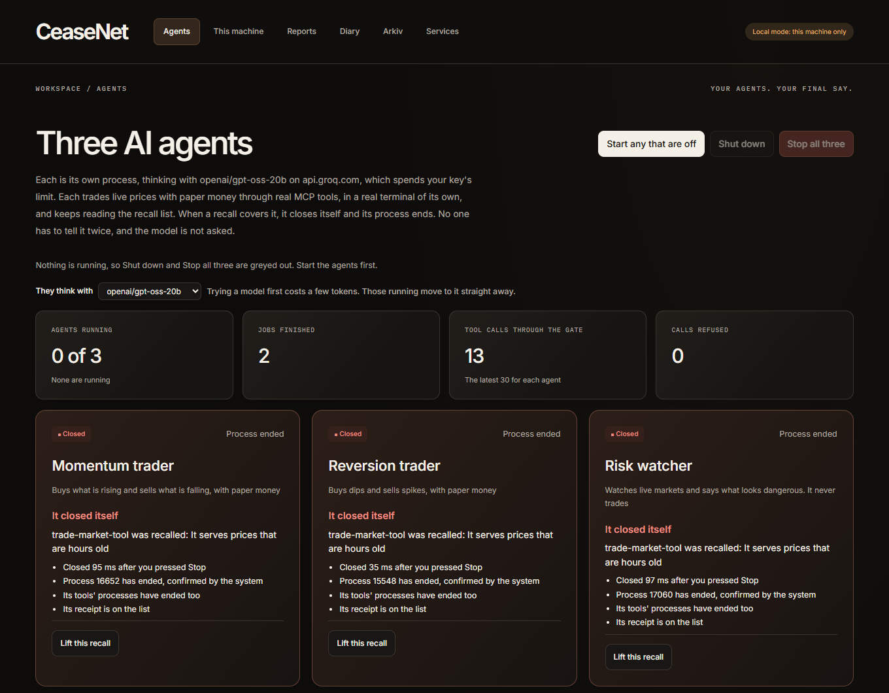
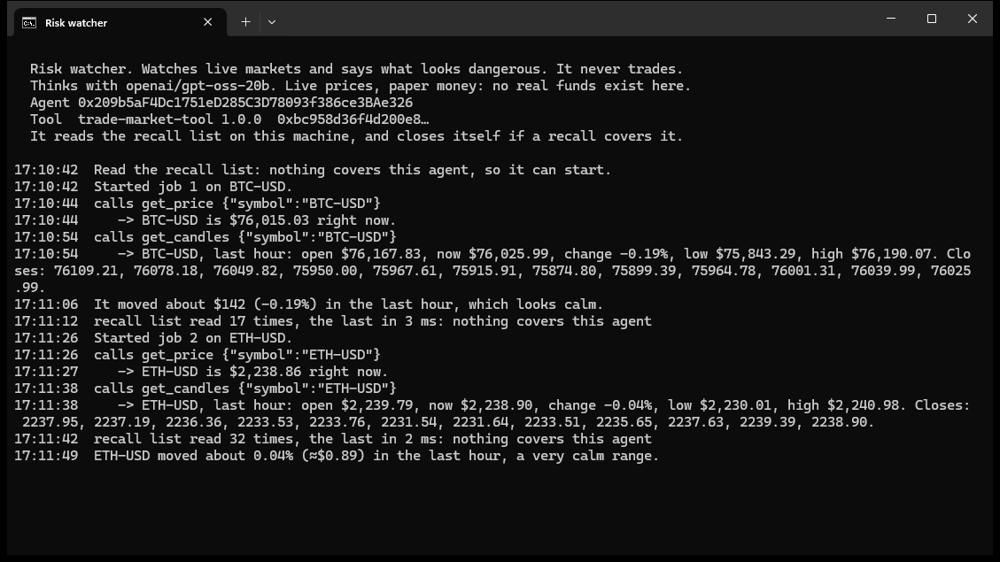
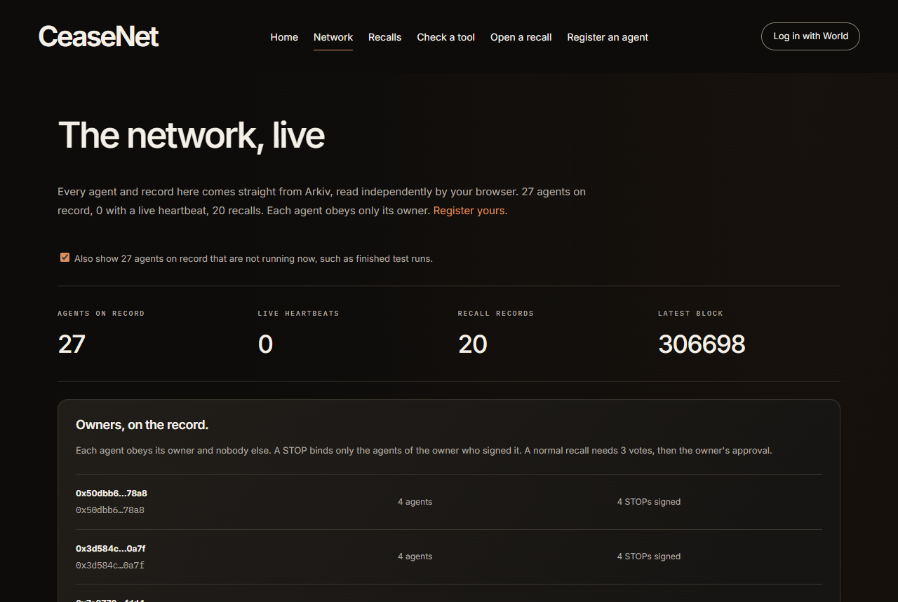
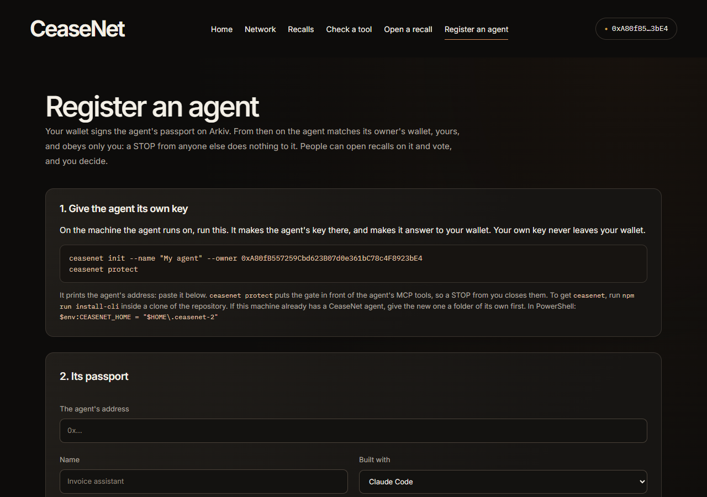
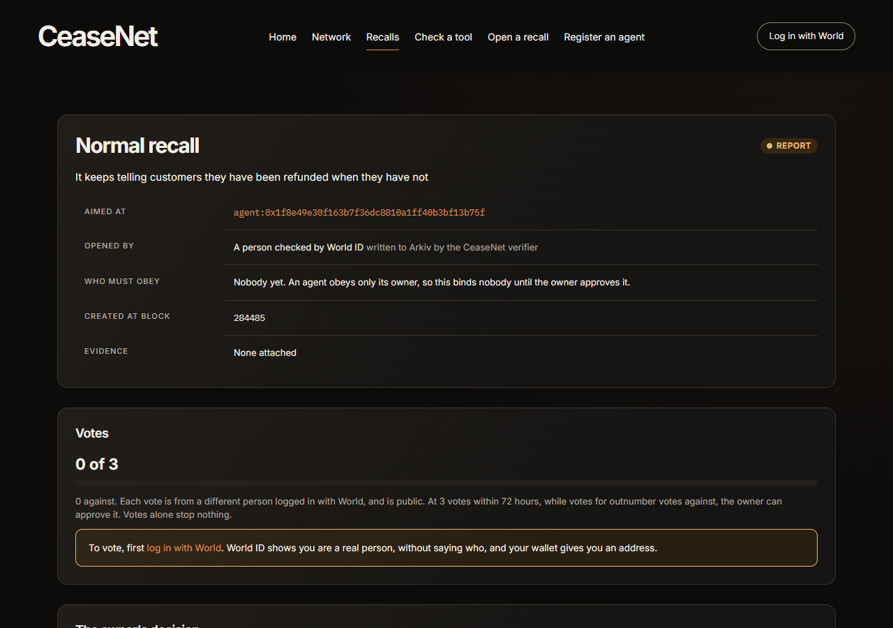
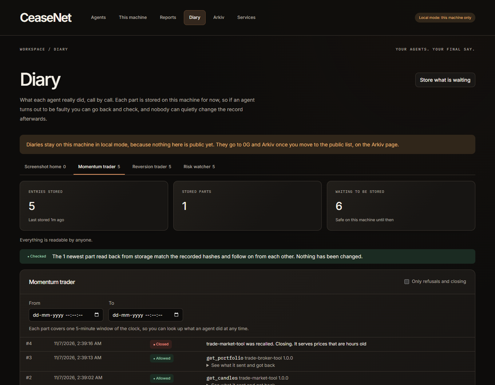
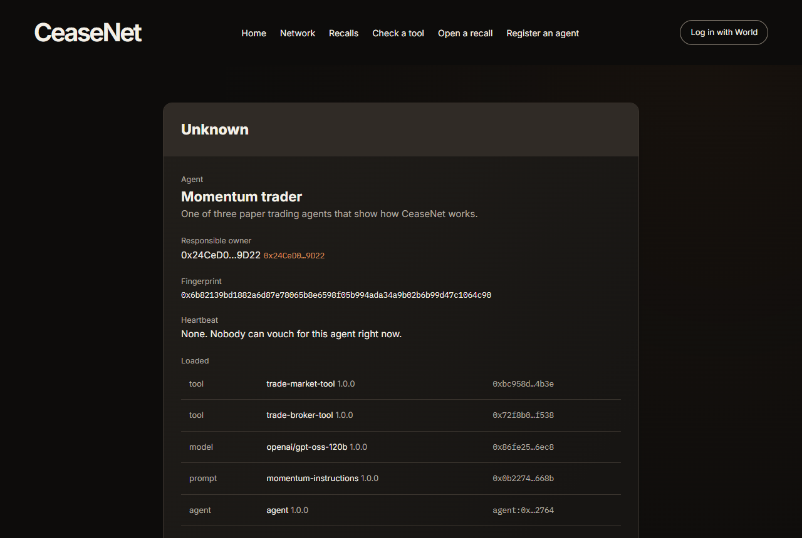

# CeaseNet

**Recalls for AI agents. Stop your agents, recall the tools they use, and see exactly what they did.**

[Live site](https://ceasenet.vercel.app/) · [Get started](#start) · [How it works](#how-it-works) · [Build on it](#open-source-build-on-it-or-replace-us) · [CROPS](#crops) · [What this does not do](#what-this-does-not-do)

[](https://github.com/GuTS805/CeaseNet/actions/workflows/test.yml) [](LICENSE)

CeaseNet sits between an AI agent and its tools, with no change to either. Press Stop and the next call is refused, the agent is told why, and the tool's process is ended. Everything the agent did goes in a diary nobody can quietly change.

It doesn't depend on us. Each gate reads a public recall list on [Arkiv](https://arkiv.network) by itself, and obeys only a STOP signed by that agent's owner. So a STOP works from another machine and keeps working if everything we run disappears, and nobody else, us included, can stop your agent. It runs on test networks today.



| | |
|---|---|
| **Stop things** | One agent, all your agents, or one tool everywhere it is used. It works with the MCP tools your agents already use, and with Claude Code's own tools such as Bash |
| **Watch it work** | Three real AI trading agents work on live prices with paper money, each in its own terminal, and close themselves when a recall covers them |
| **Look back** | Every call goes in a diary that anyone can check hasn't been changed, with its index on Arkiv |
| **Know what an agent is** | Arkiv holds who answers for each agent and, unless its owner keeps it private, a fingerprint of its exact tools, model and instructions |
| **Open a recall** | Anyone logged in with World can open a recall on an agent or a tool, and others vote. At enough votes the owner decides, and only then does the agent stop |
| **Keep it private** | One command keeps what your agents run off the public list, and both the program and the site can read through a node you run. [Who learns what](#who-learns-what) |

## Start

You need Node 22.10 or newer.

```bash
git clone https://github.com/GuTS805/CeaseNet.git && cd CeaseNet
npm install
npm run install-cli        # installs the ceasenet program

ceasenet init              # creates this agent's identity, and yours as its owner
ceasenet protect           # puts the gate in front of your agents' tools
ceasenet console           # opens the console at http://127.0.0.1:7787
```

Then restart your agent's client and use it as usual. If PowerShell says running scripts is disabled, type `npm.cmd` instead of `npm`.

`protect` finds your settings for Claude Code, Claude Desktop, Cursor, VS Code, Windsurf and Gemini CLI. It keeps a copy of each file it changes, and `ceasenet unprotect` undoes it. `ceasenet protect --dry-run` shows what it would do.

### The public list, or this machine only

| | The public list on Arkiv | This machine only (`ceasenet init --local`) |
|---|---|---|
| **Who can obey you** | Agents on any machine | Only agents on this machine |
| **Recalls, receipts and agent records** | Public, on Arkiv | A file here |
| **Diaries** | On Swarm or 0G Storage, with the index on Arkiv | A file here |
| **What it needs** | Test tokens, to write. Reading is free | Nothing |

Your agents obey recalls from the first minute either way. To write to the public list, fund your owner's wallet once, and it keeps your agents' wallets in funds from there. It needs [tGLM](https://hub.arkiv.network/faucet) for Arkiv and [0G tokens](https://faucet.0g.ai) for diaries. `ceasenet init` prints the address, and the console shows it until it is done. Your agent is then registered by itself, answering to you.

To move from one to the other, press **Move to the public list** on the console's Arkiv page, or run `ceasenet network arkiv`. On the public list, every tool call on the machine reads the chain first. If it stays out of reach for 5 minutes, your agents start asking a person, and 5 minutes after that they refuse. A node whose newest block is more than 2 minutes old counts as out of reach too, so one that has fallen behind or stopped can't keep serving a list from before a STOP.

Your agents read and write through Arkiv's public endpoint unless you choose a node yourself: `ceasenet rpc <url>` checks that it is on the same chain and up to date before switching to it, and `ceasenet rpc default` switches back. The standalone `ceasenet-guard` takes it as `ARKIV_RPC`. Tools never see either.

### Settings

`ceasenet import-settings .env` copies your model key, Arkiv access key and World ID settings into `~/.ceasenet/.env`. It leaves a wallet's secret phrase behind, and no tool ever sees these keys. [.env.example](.env.example) explains each one.

## See it work: three real AI trading agents

```bash
ceasenet agents start
ceasenet console
```

Three real terminals open, one for each agent: a momentum trader, a mean-reversion trader and a risk watcher. Each is its own process with its own key. A real model decides each step on live Coinbase prices, through real MCP servers, and you watch every call in its window. **The money is paper:** orders fill at the live price in an account in that agent's folder, starting at $10,000, and no real funds exist to lose.



Each keeps reading the recall list, and when a recall covers it, **it closes itself and its process ends,** with the reason left on screen. The model's key stays with the agent, and no tool ever sees it.

| On the Agents page, press | What happens |
|---|---|
| **Recall** on the market tool | All three use it, so all three close. Starting them again does nothing until it is lifted: they read the list first and refuse |
| **Recall** on the broker tool | The two traders close, and the risk watcher keeps working |
| **Stop this agent** | Only that one closes |
| **Stop all three** | They all close, and nothing else you run is affected |

From a terminal, `ceasenet stop trade-broker-tool --reason "It fills orders at the wrong price"` does the same as the broker's button.

Each card then shows how long closing took, that the system confirms the process has gone, and whether its receipt is on the list. In our runs they closed in under 0.4 s on this machine, and in about 5 s on the public list, where the recall's transaction has to confirm first.

They think with the model in your settings, which can be any service that speaks the OpenAI chat API (Groq's free tier works), or with Claude Code if there is none. You can switch at the top of the page. Each terminal runs for 20 minutes. Started from the console alone, with no terminal, they pause after 2 minutes with nobody looking and shut down after 15. A free-tier key has a daily allowance for each model, and the page says when one is used up. On Groq's free tier the default model gets 200,000 tokens a day, and one 20-minute session with three agents uses roughly half of that, so switch model if it runs out.

## Stop agents and recall tools

| You do this | From the console, or | What happens |
|---|---|---|
| **Stop an agent** | `ceasenet kill --reason "..."` | Every MCP tool call is refused and those tools' processes are ended. In Claude Code, its own tools such as Bash and file edits are refused too |
| **Stop all your agents** | `ceasenet kill --all --reason "..."` | The same, for every agent you own, on any machine |
| **Recall a tool** | `ceasenet stop some-tool@1.2.3 --reason "..."` | Only that tool is refused and ended, on every agent you own. A tool already recalled is never started, and an npm package recalled by name and version is never even downloaded |
| **Ask first** | `ceasenet hold some-tool` | Each call waits until you approve it at the console, which shows exactly what it would do. With nobody answering, it does not run |
| **Undo it** | `ceasenet lift <key>` | What was stopped carries on, in the same session, with nothing for the agent to do |
| **Whom it obeys** | Nothing to do | Only you. A STOP from any other key is ignored, even one aimed straight at your agent. Others open a recall, and you approve it |
| **Stop an agent elsewhere** | `ceasenet init --owner 0x...` on that machine, `ceasenet enroll 0x...` on yours | Its gate obeys your key from wherever you are, and your key never goes near that machine |

`ceasenet help` lists everything, and `ceasenet status` shows what is protected, what is not, and what is running.

## On the website, with a browser wallet

None of this needs our keys or the program. [The site](https://ceasenet.vercel.app/) reads Arkiv straight from your browser. To write, you need a browser wallet on the Rabdi testnet, with free tGLM from the [faucet](https://hub.arkiv.network/faucet).



- **Network:** every agent, owner and recall on Arkiv, drawn live from the records, with no list of keys to start from.
- **Recalls:** everything on the list, and each recall's own page. Whoever issued a STOP can connect the same wallet there to withdraw it, or to publish the exact fixed version.
- **Check a tool:** your browser downloads the whole list and checks it locally, so nobody learns which tool you asked about. It can measure any version on npm, with nothing installed or run. For something not on npm, `ceasenet check ./folder` prints its exact hash.
- **Log in with World:** your wallet's address, linked to one real person by World ID. You need it to open a recall, vote, or register an agent.
- **Open a recall:** a normal recall on any agent or tool, which needs 3 votes and then its owner's approval. If you own the agent, **stop it as the owner** instead: the whole agent, or one tool on all your agents, at once.
- **Register an agent:** its passport on Arkiv, signed by your wallet, with its address, name, framework and what it does. An agent set up with `ceasenet init --owner <your wallet>` obeys only you, and your key never goes near its machine.



## Open a recall, as someone who doesn't own the agent

An agent matches its owner's wallet and obeys only that wallet. A STOP from anyone else does nothing to it. The owner can stop anything of theirs directly, with no votes. Anyone else goes through a **normal recall**, on the public site:

1. **Log in with World.** The wallet gives an address and signs a message to show it is yours, which costs nothing. World ID shows a real, unique person is behind it, without saying who. The verifier checks both and writes a `ceasenet.human` record on Arkiv. One person can link only one wallet.
2. **Open a recall** on an agent or a tool. The wallet signs it, and the verifier writes it to Arkiv with your address as its `opener`. That counts as your vote.
3. **Others vote,** each logged in the same way. The wallet signs each vote. Each person counts once on each recall, and votes are public.
4. **At 3 votes, while votes for outnumber votes against, the owner can approve it:** on the recall's page on the site, or in the console's Reports page, which also tells them. `REPORT_VOTES_NEEDED` in your settings changes the number for the console.
5. **The owner approves** with one press. That is a STOP signed by the owner's own wallet, with `approves` naming the normal recall, so their agents obey it within seconds.



Votes alone stop nothing, because a crowd must not be able to switch off someone's agent. Only logins, recalls and votes written by the verifier count, and anything else anyone writes on the chain is ignored.

To run this yourself:

```bash
npm run keys            # creates the verifier's wallet in .env, if you do not have one. Fund it with: npm run fund
npm run verifier        # needs WORLD_APP_ID, WORLD_RP_ID and WORLD_RP_SIGNING_KEY in .env
npm run web             # the public site, on http://localhost:5173
```

The hosted site runs the same verifier as a Vercel function, [api/verifier.mjs](api/verifier.mjs), built from [apps/verifier/src/vercel.ts](apps/verifier/src/vercel.ts) with `npm run build:verifier`. It needs `WORLD_APP_ID`, `WORLD_RP_ID`, `WORLD_RP_SIGNING_KEY`, `WORLD_ENVIRONMENT`, `ARKIV_ACCESS_KEY` and `VERIFIER_PRIVATE_KEY` in the project's settings, and the site needs `VERIFIER_URL`. Only the verifier's own key goes there, never the phrase the other wallets come from.

There are no simulated people: every vote counted comes from a login on the record. In test mode, World's simulator stands in for World App, and it is one identity. A real World App login has not finished yet, so the hackathon site also offers "Skip World ID", [marked as unverified](#crops) everywhere it shows.

## Look back: what did that agent do?

Everything an agent does goes in its diary: each call, what it sent, what came back, what the gate decided, and what the model said. Each part is stored on [Swarm](arkiv/swarm.md), encrypted so only the owner can read it, with its index and hash on Arkiv. Until Swarm is set up, parts go to [0G Storage](https://0g.ai) instead. So anyone can find an agent's history from its address, and a changed entry or a missing part fails the check.



Each part covers one 5-minute window of the clock and its index records when its entries happened, so anyone can also ask Arkiv for what an agent did between two times, on the agent page or the console's Diary page. The console's Diary page reads it back and checks it, and the public site's agent page does the same with no account.

On Swarm, the whole part is encrypted to your owner key before it leaves your machine, so the table below only applies to parts on 0G. Storage there is public and permanent, and a real agent's calls can hold anything, so who can read the contents depends on the agent:

| Whose diary | What anyone can see | What only the owner can see |
|---|---|---|
| **Your own agents** | What was called, when, what the gate decided, and a hash of the contents | The contents, sealed to your owner key |
| **An agent whose owner's key is elsewhere** | The same | Nothing: the contents are not stored, only their hash |
| **The three sample agents** | Everything | |
| **Any agent kept private** (`ceasenet privacy private`) | Never stored on 0G. A part that can't go to Swarm encrypted stays on your machine, with only its hash and times on Arkiv | Everything |

You can change this with `DIARY_MODE` in your settings (`public`, `sealed` or `hashes`). Each agent stores a part every 2 minutes, and straight away when it closes. A part costs about 0.0013 0G test tokens and takes about 16 seconds, paid by your owner's wallet. Until then it waits in a file on your machine, in the clear, so nothing is lost if the network is out of reach or the wallet is empty.

## Agents on the record

Arkiv holds, for each agent, who answers for it and its **fingerprint**: one value for its exact tools, model and instructions. Any change gives a new fingerprint, anyone can recompute it, and you can search by it. So it is always possible to say exactly what an agent was running when it did something. The console's Arkiv page shows every agent with its owner, fingerprint and diary.



That is the open setting, and an owner can turn it off with `ceasenet privacy private`. The list then holds who the agent is and nothing about what it runs, and there is no fingerprint to prove afterwards. [The choices are below.](#how-much-the-public-list-sees)

## The console

`ceasenet console` runs on your machine. It listens there only, and refuses requests that name any other host or lack its token, so a web page you visit can't press Stop or approve a call.

| Page | What it shows |
|---|---|
| **Agents** | The three agents working and closing, and the tools you can recall |
| **This machine** | Your own agents' real tools and calls, approvals, and whom you obey |
| **Reports** | Normal recalls on your agents, and what is waiting for your decision |
| **Diary** | What each agent did, call by call, checked against its index |
| **Arkiv** | The live chain, your wallets, every agent on record and every record of yours, with links to the explorer |
| **Services** | Where the model, World ID, Swarm and 0G each stand right now, found by asking them. Keys are only ever shown as set or missing |

## How it works

```
  your agent's client  ──▶  ceasenet run  ──▶  the real MCP server
                             │        │
        reads the recall list         writes down every call
        before each call, and         in a file on this machine
        ends the server on a STOP               │
                             │                  ▼
                             │          the diary, on Swarm or 0G
                             ▼                  │  its hash and index
        Arkiv: recalls, receipts, owners,  ◀────┘
        fingerprints, logins and votes
                             ▲
        the verifier: World ID checks each person
```

`protect` changes one thing in your client's settings: the command that starts each MCP server now starts it through the gate. Claude Code's own tools get a `PreToolUse` hook that asks the same question.

- **The gate is in the code that runs the tools, not in the model.** A model can't talk its way past it.
- **It knows what it is running.** An `npx` server is pinned to one exact version, installed with its install scripts turned off, and measured. If its code changes after that, it is blocked. A `latest` that quietly turns malicious doesn't reach you.
- **It fails closed.** Without the list, an agent keeps working for 5 minutes, then asks a person for each call for 5 more, then refuses. Restarting doesn't reset that.
- **It remembers.** Arkiv lets an owner delete even a read-only record. A gate keeps obeying a STOP it has seen, and its public receipt proves the STOP existed.
- **It needs nothing else running.** Each gate decides alone. The console only reports and stores, and if it stops, not one call gets through that otherwise wouldn't, and nothing already written down is lost.

| Data | Where | Why |
|---|---|---|
| Recalls, receipts, owners, logins, fingerprints, votes and the diary index | [Arkiv](arkiv/schema.md) | Public, can't be edited, and readable with no account |
| Each agent's diary | Swarm, encrypted to its owner, or 0G Storage until Swarm is set up, with its hash on Arkiv | Too big for Arkiv, and a changed copy fails the check |
| What a private agent runs | A file on its own machine | Nobody else needs it: a gate decides from what it measured itself |

## What this does not do

- **Stopping an agent stops it acting, not thinking.** An open session can still reply. It can't use a covered tool.
- **An "agent" here means everything on this machine under your user.** Every Claude Code session and every protected client on it stops together, including the one you may be typing in. To stop them separately, use separate machines or users.
- **Built-in tools are covered in Claude Code only.** In other clients, stopping an agent covers its MCP tools, but not anything built into the client, such as a terminal.
- **Remote MCP servers aren't covered.** The gate sits in front of servers started on your machine. `protect` and the console name any it can't cover.
- **It can't defend against a tool that has already taken over your machine.** A tool runs as you, so while it is running it could read `~/.ceasenet`, where keys, settings and calls not yet stored are kept unencrypted, or edit your settings. A STOP prevents further use, not what already happened. To limit this, keep your owner's key on another machine with `ceasenet init --owner`.
- **A tool's dependencies aren't measured,** only its own files. A tool run through Docker or a Python runner is known only by its name and command, which the console labels.
- **Pinning means no automatic updates.** `ceasenet update <spec>` looks for a new version the next time the client starts it. A package that needs its install scripts may not run when pinned. Publishing a fix with `ceasenet fix` tells everyone what to move to, but agents don't move by themselves.
- **An agent obeys only its owner.** A maker or registry can open a normal recall and gather votes, but your agents stop only when you approve it, or stop them yourself.
- **Each call takes a moment longer.** About 0.4 s through the gate on the public list with an [access key](https://hub.arkiv.network/access-keys) (`ceasenet access-key`), and about 0.6 s without. Claude Code's own tools take about 0.2 s in local mode, and about 0.9 s on the public list without a key. An access key has a quota, and when it runs out CeaseNet carries on through the public endpoint, and the Arkiv page says so.
- **Logging in needs a verifier people can reach.** The hosted site has one, as a Vercel function. A real World App login has not finished yet: World App could not complete our request, so the hackathon site also offers "Skip World ID", marked as unverified. Owners choose whose recalls to hear with `REPORT_VERIFIER`.
- **A normal recall waits on the chain for 72 hours.** The owner sees it on the site, or in the console when it is running.
- **It only binds agents that run the gate.** A silent agent proves nothing: from outside, a lost connection and ignoring a recall look the same, so the public board says "silent", not "disobeying".
- **It runs on test networks,** and it has no users yet.

## Open source: build on it, or replace us

Everything here is [MIT](LICENSE), and so is what it stands on: all 200 packages that ship are under permissive licences, listed in [THIRD_PARTY_NOTICES.md](THIRD_PARTY_NOTICES.md), which CI keeps current. Being able to read the code is only part of it. This project is built so that you don't need us at all.

**The rules can be followed with none of our code.** [arkiv/schema.md](arkiv/schema.md#build-your-own-gate) says what each record means and what a gate must decide, and [arkiv/vectors/gate.json](arkiv/vectors/gate.json) states it as 56 cases any language can run. Our gate passes them in `npm test`. [examples/ceasenet_gate.py](examples/ceasenet_gate.py) is a second gate in Python, using only the standard library, and CI holds it to the same cases:

```bash
python examples/check_gate_vectors.py                       # 56 of 56 vectors give the verdict the rules state
python examples/ceasenet_gate.py --owner 0x... --hash 0x... # may this call go ahead? It reads the live list itself
node examples/read-without-ceasenet.mjs                     # every STOP and who obeyed it, with only the Arkiv SDK
```

When we compared the two gates on the live list, they agreed on all 46 cases we tried, and the Python gate's reading of version ranges agreed with npm's own `semver` on all 6,572 we tried. The Python gate reads the list once and keeps no memory, so unlike ours it can't keep obeying a STOP after it is deleted. Its opening comment says so.

**Every part can be replaced.** This is what depends on whom, and what happens if each one goes away:

| If this goes away | What keeps working | What stops, and how to replace it |
|---|---|---|
| **Us, and this repository** | Every gate, on its own machine, and the whole list | Updates. Anyone may fork it, and a copy of the code has all it needs |
| **Our domain, or Vercel** | Gates, the program, the console and every owner's STOP. The site is static, and also [on Swarm](#tradeoffs-we-accept) | The hosted site. `npm run web`, any static host, or [a Pages mirror](.github/workflows/pages.yml) serves it |
| **The verifier** | Every owner's STOP, which never goes near it | New logins, normal recalls and votes. `npm run verifier` runs another, and owners choose whose to hear with `REPORT_VERIFIER` |
| **World** | The same | New logins from real people. The login is one check in [the verifier](apps/verifier/src/verifier.ts) |
| **Arkiv's public endpoint** | Any other node, with `ceasenet rpc <url>` | With no other node, gates fail closed in 10 minutes |
| **The Arkiv network** | A gate keeps obeying each STOP it has seen. `ceasenet network local` works with no network at all | The public list, so owners can't reach agents on other machines. The contract would need another home |
| **npm** | Tools already pinned and installed | Pinning new ones |
| **Your model service** | Everything, because a gate uses no model | The sample agents. They take any service with the OpenAI chat API, including one you host |
| **Swarm or 0G** | Agents keep working, and diary parts wait in a file on the machine | Storing new parts |

**Nobody has to trust our laptops.** `npm ci` builds from a lockfile, and GitHub Actions are pinned to commit hashes. CI rebuilds the [hosted verifier](api/verifier.mjs) from source on every push and fails if it differs by a byte, and installs the packed program in an empty project to see that it runs. A tagged release publishes to npm [with provenance](.github/workflows/release.yml), linking the package to the commit that built it. Nothing has been released yet, so for now you install from a clone.

**To join in,** see [CONTRIBUTING.md](CONTRIBUTING.md). [SECURITY.md](SECURITY.md) says how to report a problem, and [docs/THREAT_MODEL.md](docs/THREAT_MODEL.md) says what we defend against and what we don't. Built something on the list? [Tell us](https://github.com/GuTS805/CeaseNet/issues/new?template=implementation.yml), and we will list it.

## CROPS

**Lead property: censorship resistance.** A recall has to reach an agent even when the tool's maker, a registry, a crowd or we would rather it didn't, and nobody but the agent's owner may stop it. Everything below serves that.

- **C, censorship resistance (lead).** Each gate reads Arkiv itself and obeys only a STOP its owner's wallet signed, so no server of ours stands between an owner and their agent, and nobody else can stop it or keep it from being stopped. A node that stops following the chain makes a gate fail closed, an owner can move to a node they run with `ceasenet rpc`, and the site also lives on Swarm, so losing our domain or Vercel loses nothing an owner needs.
- **O, open source.** MIT licence, and `npm ci && npm test && npm run build` works from a clean clone with no keys and no account with us. [A second gate in Python](#open-source-build-on-it-or-replace-us), using none of our code, passes the same 56 conformance vectors as ours, and every part we run has a stated replacement.
- **P, privacy.** A gate downloads its owner's whole list and matches it locally, so no node learns which tools it is checking, and `ceasenet privacy private` keeps them off the public list too. The client loads no trackers or analytics, a diary's contents are sealed to its owner, and both the program and the site can read through a node you run.
- **S, security.** Agent and owner keys are separate, the owner's can stay in a browser wallet on another machine, and the site never holds a key: every record is signed in your wallet. A pinned tool is blocked if its code changes, and the tools a gate runs get none of CeaseNet's settings or keys.

### How much the public list sees

You choose this per owner. A gate decides from what it measured itself, so none of these changes what your agents obey.

| Setting | How | What goes on the public list |
|---|---|---|
| **Open** (default) | Nothing to do | The agent's passport and owner, every tool, model and prompt it runs, its fingerprint, its heartbeat, receipts and the diary index. Anyone can then see who a recall reaches |
| **Private** | `ceasenet privacy private` | Its passport and owner, its heartbeat, a receipt naming a tool only when a STOP covered it, and the diary index. Nothing else about what it runs. Records published before the switch stay until they expire, up to 180 days |
| **Silent** | `ceasenet init --owner <wallet>` on the agent's machine, and never fund the agent's address | Nothing from the agent at all, and it still obeys. Only what the owner's wallet signs itself. There are no receipts to prove it obeyed |
| **This machine** | `ceasenet init --local` | Nothing. Only agents on this machine can obey |

We left Open as the default because a recall's reach can then be counted by anyone, which is what a public recall list is for. The sample agents are open by design.


### Who learns what

| Who | What they learn | How to take it away |
|---|---|---|
| **The Arkiv node you read through** | Your IP address, your owner's address and when you check. Never which tools a gate is checking, because it downloads the whole list | Run your own: `ceasenet rpc <url>`, or the setting on the site's Network page |
| **Anyone reading Arkiv** | What the table above says, and for each login, that this wallet belongs to a person, along with that wallet's votes | Choose a setting above. Logging in is optional: you need it only to open or vote on a recall, or to register an agent through the site |
| **Our verifier** | Your wallet address and a per-action World ID number, when you log in, open a recall or vote. It needs neither to stop your own agents | Run your own from this repository, or don't log in |
| **World** | That a person proved for our action, a hash of your wallet's address that the proof is bound to, and your device's IP address. Not who you are | Don't log in |
| **Vercel, our host** | The IP address of each page load and each verifier call | The Swarm copy, or run the site yourself. Logging in and voting still go through a verifier |
| **npm** | Which package you downloaded, when a gate pins a tool or the site measures one | Measure a copy you already have with `ceasenet check ./folder`, which asks npm nothing |
| **Your model service** | What the sample trading agents ask their model. A client you protect talks to its own model as it always did, and the gate adds nothing | Don't run the sample agents, or use a model you host |
| **Us** | Nothing beyond the verifier row. There are no accounts, trackers or analytics, and CeaseNet keeps nothing in your browser but a node you chose | |

### Tradeoffs we accept

- **Logging in is public.** It links your wallet address to "a person checked by World ID" on Arkiv, and your votes are public under that address. That is what lets anyone recount them.
- **The verifier is one key.** It decides who counts as a person, so a dishonest one could invent votes, but votes stop nothing until the owner approves. It runs as a Vercel function holding only its own key, which can write logins, normal recalls and votes, and never a STOP that binds an agent. Anyone can run their own from this repository.
- **A private agent can't be counted.** A tool recall's page can't show it among the agents covered, and the site can't tell its owner a tool recall concerns them. The console on its own machine still can. An owner's console on another machine sees only who the agent is.
- **Timing is still visible** unless an agent is silent. A heartbeat and a diary index show when an agent is running, though not what it does.
- **"Skip World ID" is on for the hackathon** (`VERIFIER_ALLOW_BYPASS`), because World App could not finish our request in time. One person can then vote from several wallets. Such logins are marked `unverified-` on the record and on every page. Turn it off for real use.
- **The public Swarm gateway refuses websites,** so the Swarm copy opens through your own Bee node, such as Swarm Desktop or Nook, at `http://localhost:1633/bzz/2a58c5b6be456742103a81c7fec532c2780da1eaab4365e6d11600fa5a6b3a03/`. It reads Arkiv's public endpoint, with no access key in it.

### We assume that

- your own machine is not already compromised, as [above](#what-this-does-not-do)
- the Arkiv node a gate reads serves correct data. A node that hides records can delay a recall, which is why an unreachable list fails closed. One that falls behind or stops is caught, because a gate refuses a list more than 2 minutes old by this machine's clock, but one that hides records while keeping up with the chain is not. The remedy is a node you run, through `ceasenet rpc`
- someone saw a record before it was deleted. Arkiv has no historical reads, so a deleted STOP stays provable only through receipts, gate memory and independent watchers

## Checks

`npm test` needs no keys or network. These use the real thing:

| Command | What it proves |
|---|---|
| `npm run product-check` | The built program, used as a person would, with a real MCP server from npm and a standard client: protecting a settings file, calls, the console, stopping a tool and an agent, processes ending, restarts, approvals, lifting and removing it. Needs no wallet |
| `npm run product-check -- --arkiv ~/.ceasenet` | All of that on the live public list, using your funded home |
| `npm run agents-check` | The three real agents doing real work and closing, checked against the system rather than their word. Spends model requests. Add `--arkiv` to run it on the live chain, funded from the treasury in `.env`, with what is left returned afterwards |
| `npm run records-check` | On the live networks: real diaries on 0G with their index on Arkiv, read back as a stranger with no wallet, sealed contents, fingerprints, the verifier refusing anyone not logged in, and an owner's direct stop. Funded from the treasury in `.env`, with what is left returned afterwards |
| `npm run smoke` | Every Arkiv behaviour the design relies on. Needs the demo's keys |
| `npm run friction` | Reproduces each problem in our [Arkiv feedback](arkiv/friction.md). Needs the demo's keys |
| `npm run model-check`, `diary-check`, `swarm-check`, `agent-pass-check` | The optional pieces against their live services |

With no tGLM the agent still obeys the list. It just publishes nothing about itself.

**Queries you can run, with no key and no wallet.** `npm run query` lists every STOP with who issued it and its receipts, and each agent's owner, fingerprint and diary. Or with nothing installed, on Rabdi (chain 7794095):

```bash
# Every STOP, with who issued it
curl -s https://rpc.rabdi.db-chain.testnet.arkiv.network/ -H 'content-type: application/json' -d @arkiv/query.json

# Where every agent's diary is stored
curl -s https://rpc.rabdi.db-chain.testnet.arkiv.network/ -H 'content-type: application/json' -d @arkiv/query-diaries.json

# What one agent did between two times
curl -s https://rpc.rabdi.db-chain.testnet.arkiv.network/ -H 'content-type: application/json' -d @arkiv/query-diaries-by-time.json
```

Anyone can write any record, so these show everyone's. A gate's own query adds `AND $creator = addr(0x...)` for its owner, which the chain sets and nobody can fake. That is why a STOP from anyone else changes nothing.

<details>
<summary><strong>Wallets that wrote entities</strong></summary>

| Role | Address |
|---|---|
| Treasury, which funds the others | `0x88Ba26055f80E565Afd9706ac66b3B523160eD08` |
| Tool maker | `0xd33611D47a70192F31CBa3Ac161d7061F276485f` |
| Security council (regulator) | `0x6b135261aBF3707da627dc7494727176D64b0AD8` |
| Tool registry | `0x9A2088c25aDe29a50Dbc154924A823A90b4A8A91` |
| Verifier, for logins, normal recalls and votes | `0x8ea3c7A2aa463B563892410589f01867DfAe7766` |
| Asha Exports (owner, agent) | `0x3f53e130327F0E594aFfCA9c7c30b56d276b93C6`, `0x8D2554bd95C650448dC58b0c9711773b9736ab10` |
| Bandra Freight (owner, agent) | `0x82c3072f28547c882C64F1e84B3f4562a0D5b153`, `0x48113119e0C59C6063Aa8dacB20851b3dB91eE1a` |
| Coastal Foods (owner, agent) | `0xa10db75Aa52ff086C68bbe86523F3Dd710306a32`, `0x36d030406493A524d84c39bfc2fdbAE6a955a962` |
| Outsider, for the fake STOP | `0xE16525DD63fF2Ff570e31762798b87199D23FB3f` |
| Live checks only (`npm run smoke`, `npm run friction`) | `0xc784d92e6B8AFAfBc0f042Db82F5841665e7dFa4`, `0x4cf240e7E978AE82100A81De4A206e38645E1750`, `0x90a21122Ba0cAe96bbA0A5a15DE2Bc6F7598685b`, `0x01203FfBa0Cb1Cb02F36Fa76a45846275bd22997` |
| `npm run agents-check` and `records-check` | A new owner and agents for each run, whose records show who they answer to |

</details>

Documents: [schema](arkiv/schema.md), [feedback](arkiv/friction.md), [reach](arkiv/reach.md), [why Arkiv](arkiv/why-arkiv.md), [how we use Arkiv](arkiv/how-you-use-arkiv.md), [Swarm](arkiv/swarm.md).

## Sponsors

| Sponsor | How it's used | Details |
|---|---|---|
| **Arkiv** | The recall list itself: what every gate reads, and where owners, fingerprints, logins, votes and the diary index live | [arkiv/](arkiv/) |
| **World** | IDKit: log in once, one person per wallet, so each vote on a recall is a different person. Agent Pass: a real person approves a paused call | [docs/world.md](docs/world.md) |
| **Swarm** | Every agent's diary, encrypted to its owner, and a copy of the site that survives losing our domain | [arkiv/swarm.md](arkiv/swarm.md) |
| **0G** | Agents' diaries until Swarm is set up. Not entered for a 0G prize | [diaryService.ts](packages/cli/src/diaryService.ts) |
| **Ethereum Foundation** | The CROPS section above, and the reason the design has no central party | |

## Layout

```
packages/cli     The ceasenet program: setup, protecting clients, the guard, the three trading agents,
                 the diary service, recalls and the console's backend
packages/core    Records, the gate's decisions, Arkiv reads and writes
packages/guard   The gate and MCP proxy, the diary format, Swarm client and Agent Pass
apps/console     The console's pages
apps/web         The public site: login, recalls and votes, agent pages, "Check a tool", the network map,
                 registering an agent, and stopping one with a browser wallet
apps/verifier    Checks World ID proofs and signed requests, and writes logins, normal recalls and votes
api              The verifier, built for Vercel
apps/demo, tools An earlier scripted demo. The program also uses its model and 0G code
examples         A whole gate in Python, and a reader, that use none of this code
scripts          Setup and live checks
arkiv            The public contract, its conformance vectors, and sponsor documents
docs             The threat model, the plan and AI usage
```

## How this was built

Built at ETHGlobal Mumbai 2026 with heavy use of AI. See [docs/ai-usage.md](docs/ai-usage.md) for what was done how, [docs/prompts.md](docs/prompts.md) for the prompts, [docs/plan.md](docs/plan.md) for the plan, and [docs/prior-work.md](docs/prior-work.md) for what existed before kickoff. The filming script is in [docs/demo-script.md](docs/demo-script.md), and the earlier robot version of the idea is on the [`robots`](https://github.com/GuTS805/CeaseNet/tree/robots) branch.

## Licence

[MIT](LICENSE). See also [CONTRIBUTING.md](CONTRIBUTING.md), [SECURITY.md](SECURITY.md), the [Code of Conduct](CODE_OF_CONDUCT.md), the [changelog](CHANGELOG.md) and the [third-party notices](THIRD_PARTY_NOTICES.md).
