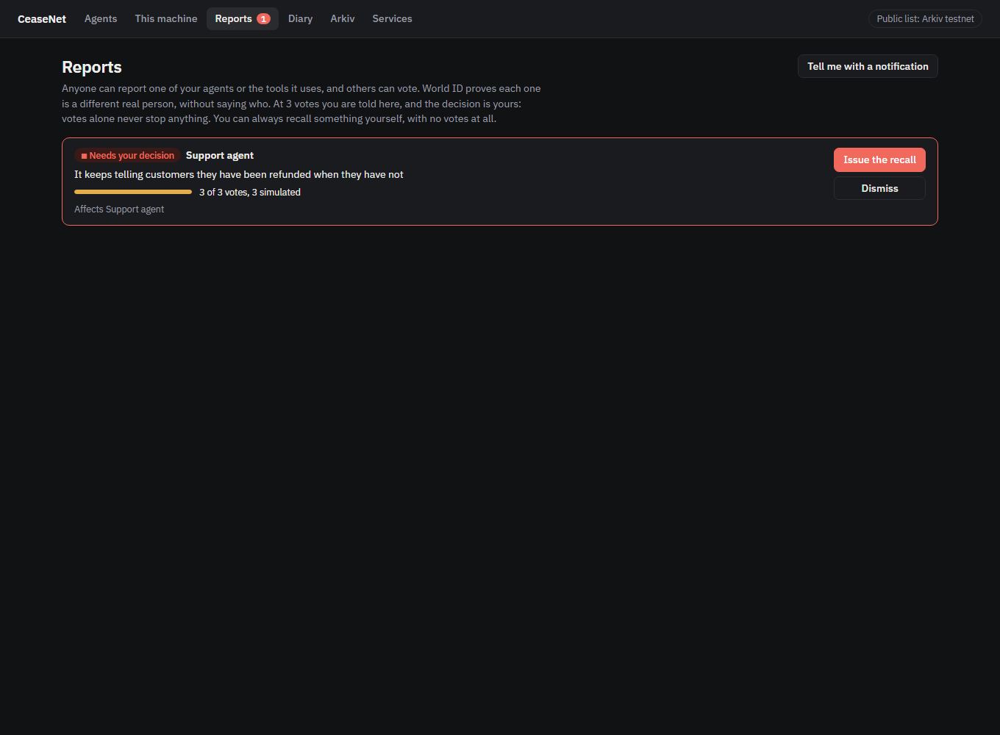

# CeaseNet

**Stop your AI agents, recall the tools they use, and see exactly what they did.**

CeaseNet sits between an AI agent and its tools, with no change to either. Press Stop and the next call is refused, the agent is told why, and the tool's process is ended. Everything the agent did goes in a diary nobody can quietly change. Anyone can report a bad agent, and its owner decides what to do.

It doesn't depend on us. Each gate reads a public recall list on [Arkiv](https://arkiv.network) by itself, so a STOP works from another machine and keeps working if everything we run disappears. It runs on test networks today.

**Public site:** [ceasenet.vercel.app](https://ceasenet.vercel.app/). It reads the recall list, receipts, reports and the network map straight from Arkiv in your browser, with no server of ours.


| | |
|---|---|
| **Stop things** | Stop one agent, all your agents, or one tool everywhere it is used. It works with the MCP tools your agents already use, and with Claude Code's own tools such as Bash |
| **Watch it work** | Three real AI trading agents work on live prices with paper money, each in its own terminal, keep checking the recall list, and close themselves when a recall covers them |
| **Look back** | Every call is saved to a diary on 0G Storage, with its index on Arkiv. Anyone can check it hasn't been changed |
| **Know what an agent is** | Arkiv holds who answers for each agent, and a fingerprint of its exact tools, model and instructions |
| **Report a problem** | Anyone can report an agent or a tool. World ID shows each vote is a different real person. At enough votes, the owner is told and decides |

## Start

You need Node 22.10 or newer.

```bash
git clone https://github.com/GuTS805/CeaseNet.git && cd CeaseNet
npm install
npm run install-cli        # installs the ceasenet program

ceasenet init              # creates this agent's identity, and yours as its owner
ceasenet protect           # puts the gate in front of your agents' tools
ceasenet console           # opens the console at http://127.0.0.1:7787
```

Then restart your agent's client and use it as usual. If PowerShell says running scripts is disabled, type `npm.cmd` instead of `npm`.

`protect` finds your settings for Claude Code, Claude Desktop, Cursor, VS Code, Windsurf and Gemini CLI. It keeps a copy of each file it changes, and `ceasenet unprotect` undoes it. `ceasenet protect --dry-run` shows what it would do.

### The public list, or this machine only

| | The public list on Arkiv | This machine only (`ceasenet init --local`) |
|---|---|---|
| **Who can obey you** | Agents on any machine | Only agents on this machine |
| **Recalls, receipts and agent records** | Public, on Arkiv | A file here |
| **Diaries** | On 0G Storage, with the index on Arkiv | A file here |
| **What it needs** | Test tokens, to write. Reading is free | Nothing |

Your agents obey recalls from the first minute either way. To write to the public list, fund your owner's wallet once, and it keeps your agents' wallets in funds from there. It needs [tGLM](https://hub.arkiv.network/faucet) for Arkiv and [0G tokens](https://faucet.0g.ai) for diaries. `ceasenet init` prints the address, and the console shows it until it is done. Your trust list is then published and your agent registered by itself.

To move from one to the other, press **Move to the public list** on the console's Arkiv page, or run `ceasenet network arkiv`. On the public list, every tool call on the machine reads the chain first. If it stays out of reach for 5 minutes, your agents start asking a person, and 5 minutes after that they refuse.

### Settings

`ceasenet import-settings .env` copies your model key, Arkiv access key and World ID settings into `~/.ceasenet/.env`. It leaves a wallet's secret phrase behind, and no tool ever sees these keys. [.env.example](.env.example) explains each one.

## See it work: three real AI trading agents

```bash
ceasenet agents start
ceasenet console
```

Three real terminals open, one for each agent: a momentum trader, a mean-reversion trader and a risk watcher. Each is its own process with its own key. A real model decides each step on live Coinbase prices, through real MCP servers, and you watch every call in its window. **The money is paper:** orders fill at the live price in an account in that agent's folder, starting at $10,000, and no real funds exist to lose. Each keeps reading the recall list, and when a recall covers it, **it closes itself and its process ends,** with the reason left on screen. The model's key stays with the agent, and no tool ever sees it.

| On the Agents page, press | What happens |
|---|---|
| **Recall** on the market tool | All three use it, so all three close. Starting them again does nothing until it is lifted: they read the list first and refuse |
| **Recall** on the broker tool | The two traders close, and the risk watcher keeps working |
| **Stop this agent** | Only that one closes |
| **Stop all three** | They all close, and nothing else you run is affected |

From a terminal, `ceasenet stop trade-broker-tool --reason "It fills orders at the wrong price"` does the same as the broker's button.

Each card then shows how long closing took, that the system confirms the process has gone, and whether its receipt is on the list. In our runs they decided to close in about 0.3 s on this machine, and about 5 s on the public list, where the recall's transaction has to confirm first.

They think with the model in your settings, which can be any service that speaks the OpenAI chat API (Groq's free tier works), or with Claude Code if there is none. You can switch at the top of the page. Each terminal runs for 20 minutes. Started from the console alone, with no terminal, they pause after 2 minutes with nobody looking and shut down after 15. A free-tier key has a daily allowance for each model, and the page says when one is used up. On Groq's free tier the default model gets 200,000 tokens a day, and one 20-minute session with three agents uses roughly half of that, so switch model if it runs out.

## On the website, with a browser wallet

None of this needs the demo, our keys or the program. You need a browser wallet on the Rabdi testnet, with free tGLM from the [faucet](https://hub.arkiv.network/faucet).

- **Protect an agent:** choose whose recalls your agents obey, and register an agent. Your choices go on Arkiv, signed by your wallet. An agent set up with `ceasenet init --owner <your wallet>` obeys that list, and your key never goes near its machine.
- **Recall a tool:** measure any version on npm in your browser, then sign a STOP. Nothing is installed or run, and it binds only owners who follow your key. For something not on npm, `ceasenet check ./folder` prints its exact hash.
- **Network:** every agent, key and recall on Arkiv, drawn live from the records, with no list of keys to start from.
- **The recall's own page:** whoever issued a STOP can connect the same wallet there to withdraw it, or to publish the exact fixed version.

## Stop agents and recall tools

| You do this | From the console, or | What happens |
|---|---|---|
| **Stop an agent** | `ceasenet kill --reason "..."` | Every MCP tool call is refused and those tools' processes are ended. In Claude Code, its own tools such as Bash and file edits are refused too |
| **Stop all your agents** | `ceasenet kill --all --reason "..."` | The same, for every agent you own, on any machine |
| **Recall a tool** | `ceasenet stop some-tool@1.2.3 --reason "..."` | Only that tool is refused and ended, on every agent that obeys you. A tool already recalled is never started, and an npm package recalled by name and version is never even downloaded |
| **Ask first** | `ceasenet hold some-tool` | Each call waits until you approve it at the console, which shows exactly what it would do. With nobody answering, it does not run |
| **Undo it** | `ceasenet lift <key>` | What was stopped carries on, in the same session, with nothing for the agent to do |
| **Choose whom to obey** | `ceasenet follow 0x...` | You obey yourself, and nobody else until you say so. A STOP from any other key is ignored, even one aimed straight at your agent |
| **Stop an agent elsewhere** | `ceasenet init --owner 0x...` on that machine, `ceasenet enroll 0x...` on yours | Its gate obeys your key from wherever you are, and your key never goes near that machine |

`ceasenet help` lists everything, and `ceasenet status` shows what is protected, what is not, and what is running.

## Look back: what did that agent do?


Everything an agent does goes in its diary: each call, what it sent, what came back, what the gate decided, and what the model said. Each part is stored on [Swarm](arkiv/swarm.md), encrypted so only the owner can read it, with its index and hash on Arkiv. Until Swarm is set up, parts go to [0G Storage](https://0g.ai) instead. So anyone can find an agent's history from its address, and a changed entry or a missing part fails the check. Each part covers one 5-minute window of the clock and its index records when its entries happened, so anyone can also ask Arkiv for what an agent did between two times, on the agent page or the console's Diary page. The console's Diary page reads it back and checks it, and the public site's agent page does the same with no account.

On Swarm, the whole part is encrypted to your owner key before it leaves your machine, so the table below only applies to parts on 0G. Storage there is public and permanent, and a real agent's calls can hold anything, so who can read the contents depends on the agent:

| Whose diary | What anyone can see | What only the owner can see |
|---|---|---|
| **Your own agents** | What was called, when, what the gate decided, and a hash of the contents | The contents, sealed to your owner key |
| **An agent whose owner's key is elsewhere** | The same | Nothing: the contents are not stored, only their hash |
| **The three sample agents** | Everything | |

You can change this with `DIARY_MODE` in your settings (`public`, `sealed` or `hashes`). Each agent stores a part every 2 minutes, and straight away when it closes. A part costs about 0.0013 0G test tokens and takes about 16 seconds, paid by your owner's wallet. Until then it waits in a file on your machine, in the clear, so nothing is lost if the network is out of reach or the wallet is empty.

## Agents on the record

Arkiv holds, for each agent, who answers for it and its **fingerprint**: one value for its exact tools, model and instructions. Any change gives a new fingerprint, anyone can recompute it, and you can search by it. So it is always possible to say exactly what an agent was running when it did something. The console's Arkiv page shows every agent with its owner, fingerprint and diary.

## Report a problem, as someone who doesn't own the agent



An owner can recall anything of theirs directly, with no votes. Anyone else can **report** an agent or a tool, on the public site's Report page:

1. **They file it,** with World ID showing they are a real person, without saying who. That counts as their vote.
2. **Others vote,** the same way. Each person counts once on each report.
3. **At 3 votes, while votes for outnumber votes against, the owner is told:** on every page of the console, and with a browser notification if they turned that on. `REPORT_VOTES_NEEDED` in your settings changes the number.
4. **The owner decides.** They can issue a recall with one press, or dismiss it.

Votes alone stop nothing, because a crowd must not be able to switch off someone's agent. Only reports and votes checked by a verifier count, and anything else anyone writes on the chain is ignored.

To run this yourself:

```bash
npm run keys            # creates the verifier's wallet in .env, if you do not have one. Fund it with: npm run fund
npm run verifier        # needs WORLD_APP_ID, WORLD_RP_ID and WORLD_RP_SIGNING_KEY in .env
npm run web             # the public site, on http://localhost:5173
```

World's simulator can only ever be one identity, so to show the whole flow use `npm run verifier:test` in place of `npm run verifier`. It adds simulated people, each marked as simulated on the public record and on every page, and production refuses them.

## The console

`ceasenet console` runs on your machine. It listens there only, and refuses requests that name any other host or lack its token, so a web page you visit can't press Stop or approve a call.

| Page | What it shows |
|---|---|
| **Agents** | The three agents working and closing, and the tools you can recall |
| **This machine** | Your own agents' real tools and calls, approvals, and whom you obey |
| **Reports** | What people have reported about your agents, and what is waiting for your decision |
| **Diary** | What each agent did, call by call, checked against its index |
| **Arkiv** | The live chain, your wallets, every agent on record and every record of yours, with links to the explorer |
| **Services** | Where the model, World ID, Swarm and 0G each stand right now, found by asking them. Keys are only ever shown as set or missing |

## How it works

```
  your agent's client  ──▶  ceasenet run  ──▶  the real MCP server
                             │        │
        reads the recall list         writes down every call
        before each call, and         in a file on this machine
        ends the server on a STOP               │
                             │                  ▼
                             │          the diary, on 0G Storage
                             ▼                  │  its hash and index
        Arkiv: recalls, receipts, owners,  ◀────┘
        fingerprints, reports and votes
                             ▲
        the verifier: World ID checks each person
```

`protect` changes one thing in your client's settings: the command that starts each MCP server now starts it through the gate. Claude Code's own tools get a `PreToolUse` hook that asks the same question.

- **The gate is in the code that runs the tools, not in the model.** A model can't talk its way past it.
- **It knows what it is running.** An `npx` server is pinned to one exact version, installed with its install scripts turned off, and measured. If its code changes after that, it is blocked. A `latest` that quietly turns malicious doesn't reach you.
- **It fails closed.** Without the list, an agent keeps working for 5 minutes, then asks a person for each call for 5 more, then refuses. Restarting doesn't reset that.
- **It remembers.** Arkiv lets an owner delete even a read-only record. A gate keeps obeying a STOP it has seen, and its public receipt proves the STOP existed.
- **It needs nothing else running.** Each gate decides alone. The console only reports and stores, and if it stops, not one call gets through that otherwise wouldn't, and nothing already written down is lost.

| Data | Where | Why |
|---|---|---|
| Recalls, receipts, trust lists, owners, fingerprints, reports, votes and the diary index | [Arkiv](arkiv/schema.md) | Public, can't be edited, and readable with no account |
| Each agent's diary | Swarm, encrypted to its owner, or 0G Storage until Swarm is set up, with its hash on Arkiv | Too big for Arkiv, and a changed copy fails the check |
| Fixed tools and sealed evidence, in the scripted demo | [Swarm](arkiv/swarm.md), with references on Arkiv | Fixes must survive the maker's site going away |

## What this does not do

- **Stopping an agent stops it acting, not thinking.** An open session can still reply. It can't use a covered tool.
- **An "agent" here means everything on this machine under your user.** Every Claude Code session and every protected client on it stops together, including the one you may be typing in. To stop them separately, use separate machines or users.
- **Built-in tools are covered in Claude Code only.** In other clients, stopping an agent covers its MCP tools, but not anything built into the client, such as a terminal.
- **Remote MCP servers aren't covered.** The gate sits in front of servers started on your machine. `protect` and the console name any it can't cover.
- **It can't defend against a tool that has already taken over your machine.** A tool runs as you, so while it is running it could read `~/.ceasenet`, where keys, settings and calls not yet stored are kept unencrypted, or edit your settings. A STOP prevents further use, not what already happened. To limit this, keep your owner's key on another machine with `ceasenet init --owner`.
- **A tool's dependencies aren't measured,** only its own files. A tool run through Docker or a Python runner is known only by its name and command, which the console labels.
- **Pinning means no automatic updates.** `ceasenet update <spec>` looks for a new version the next time the client starts it. A package that needs its install scripts may not run when pinned. Publishing a fix with `ceasenet fix` tells everyone what to move to, but agents don't move by themselves.
- **Nobody publishes recalls for tools in the wild yet.** You start by obeying only yourself, so until a maker or registry you trust issues them, you only get the recalls you issue.
- **Each call takes a moment longer.** About 0.4 s through the gate on the public list with an [access key](https://hub.arkiv.network/access-keys) (`ceasenet access-key`), and about 0.6 s without. Claude Code's own tools take about 0.2 s in local mode, and about 0.9 s on the public list without a key. An access key has a quota, and when it runs out CeaseNet carries on through the public endpoint, and the Arkiv page says so.
- **Reports need a verifier people can reach,** and today that means running your own and hosting it. Owners choose whose to listen to with `REPORT_VERIFIER`. Filing with a real World ID has only been tested against a stand-in for World's service, though the same checks on votes have been accepted by World itself.
- **A report only reaches an owner whose console is running.** A report and its votes wait on the chain for 72 hours.
- **It only binds agents that run the gate.** A silent agent proves nothing: from outside, a lost connection and ignoring a recall look the same, so the public board says "silent", not "disobeying".
- **It runs on test networks,** and it has no users yet.

## Checks

`npm test` needs no keys or network. These use the real thing:

| Command | What it proves |
|---|---|
| `npm run product-check` | The built program, used as a person would, with a real MCP server from npm and a standard client: protecting a settings file, calls, the console, stopping a tool and an agent, processes ending, restarts, approvals, lifting and removing it. Needs no wallet |
| `npm run product-check -- --arkiv ~/.ceasenet` | All of that on the live public list, using your funded home |
| `npm run agents-check` | The three real agents doing real work and closing, checked against the system rather than their word. Spends model requests. Add `--arkiv` to run it on the live chain, funded from the treasury in `.env`, with what is left returned afterwards |
| `npm run records-check` | On the live networks: real diaries on 0G with their index on Arkiv, read back as a stranger with no wallet, sealed contents, fingerprints, and a report reaching its owner through votes. Votes are simulated, because World's simulator is one identity. Funded from the treasury in `.env`, with what is left returned afterwards |
| `npm run smoke` | Every Arkiv behaviour the design relies on. Needs the demo's keys |
| `npm run friction` | Reproduces each problem in our [Arkiv feedback](arkiv/friction.md). Needs the demo's keys |
| `npm run model-check`, `diary-check`, `swarm-check`, `agent-pass-check` | The optional pieces against their live services |

With no tGLM the agent still obeys the list. It just publishes nothing about itself.

**Queries you can run, with no key and no wallet:**

`npm run product-check` runs all of this on the live testnet with new keys and this repository's own tool, and removes its records afterwards. `npm run product-check -- --npm` does it with a real package from npm, which means downloading that package and running it on your machine.

That lists every STOP with who issued it and its receipts, the reports and their votes, and each agent's owner, fingerprint and diary. Or with nothing installed, on Rabdi (chain 7794095):

```bash
# Every STOP, with who issued it
curl -s https://rpc.rabdi.db-chain.testnet.arkiv.network/ -H 'content-type: application/json' -d @arkiv/query.json

# Where every agent's diary is stored
curl -s https://rpc.rabdi.db-chain.testnet.arkiv.network/ -H 'content-type: application/json' -d @arkiv/query-diaries.json

# What one agent did between two times
curl -s https://rpc.rabdi.db-chain.testnet.arkiv.network/ -H 'content-type: application/json' -d @arkiv/query-diaries-by-time.json
```

Anyone can write any record, so these show everyone's. A gate's own query adds `AND $creator = addr(0x...)` for the keys its owner follows, which the chain sets and nobody can fake. That is why a fake STOP changes nothing.

**Wallets that wrote entities:**

| Role | Address |
|---|---|
| Treasury, which funds the others | `0x88Ba26055f80E565Afd9706ac66b3B523160eD08` |
| Tool maker | `0xd33611D47a70192F31CBa3Ac161d7061F276485f` |
| Security council (regulator) | `0x6b135261aBF3707da627dc7494727176D64b0AD8` |
| Tool registry | `0x9A2088c25aDe29a50Dbc154924A823A90b4A8A91` |
| Verifier, for reports and votes | `0x8ea3c7A2aa463B563892410589f01867DfAe7766` |
| Asha Exports (owner, agent) | `0x3f53e130327F0E594aFfCA9c7c30b56d276b93C6`, `0x8D2554bd95C650448dC58b0c9711773b9736ab10` |
| Bandra Freight (owner, agent) | `0x82c3072f28547c882C64F1e84B3f4562a0D5b153`, `0x48113119e0C59C6063Aa8dacB20851b3dB91eE1a` |
| Coastal Foods (owner, agent) | `0xa10db75Aa52ff086C68bbe86523F3Dd710306a32`, `0x36d030406493A524d84c39bfc2fdbAE6a955a962` |
| Outsider, for the fake STOP | `0xE16525DD63fF2Ff570e31762798b87199D23FB3f` |
| Live checks only (`npm run smoke`, `npm run friction`) | `0xc784d92e6B8AFAfBc0f042Db82F5841665e7dFa4`, `0x4cf240e7E978AE82100A81De4A206e38645E1750`, `0x90a21122Ba0cAe96bbA0A5a15DE2Bc6F7598685b`, `0x01203FfBa0Cb1Cb02F36Fa76a45846275bd22997` |
| `npm run agents-check` and `records-check` | A new owner and agents for each run, whose records show who they answer to |

Documents: [schema](arkiv/schema.md), [feedback](arkiv/friction.md), [reach](arkiv/reach.md), [why Arkiv](arkiv/why-arkiv.md), [how we use Arkiv](arkiv/how-you-use-arkiv.md), [Swarm](arkiv/swarm.md).

## CROPS

**Censorship resistance.** Each gate reads Arkiv itself, so nothing of ours stands between a recall and an agent. If the website and everything else we run disappear, agents keep obeying. An owner replaces any issuer by publishing a new trust list and any verifier with a setting, and recalls need no approval from us. A diary's index is on Arkiv and its contents on 0G, so an agent's record does not depend on us either.

**Open source.** MIT licence. `npm install && npm test && npm run build` works from this repository alone, with no keys. Using the product needs no account with us. Writing to the public list needs test tokens. Reading it needs nothing.

**Privacy.** The Arkiv RPC learns your IP and which keys you follow, not which tools you run, because the gate downloads all their recalls and matches locally. The same goes for the "Check a tool" page. Publishing a loadout, heartbeat and receipts is what lets others see that an agent obeyed, and it is optional: an agent whose wallet has no funds still obeys, and leaves no public trace. Your own agents' diaries seal each call's contents to your key, so what is public is only what happened and when. The model provider sees what the agent sends it, and you choose who that is. World learns only that someone proved for this app's action, and Arkiv gets a hash scoped to one report, so one person's votes can't be linked across reports. The site has no trackers.

**Security.** Agents and owners have separate keys, and an owner's can live on another machine. The tools a gate runs are given their own settings and none of CeaseNet's. A pinned package is measured, and blocked if its code changes. Votes can't stop anything, so nobody gains power over your agent by gathering them. We assume that:
- the keys on your trust list are honest. A stolen issuer key can stop your tool, but not run code on your machine, and removing it from your list ends that
- the verifier you listen to is honest. A dishonest one can bother you with false reports, but can't stop anything
- your own machine is not already compromised, as [above](#what-this-does-not-do)
- Arkiv's testnet serves correct data. A node that hides records can delay a recall, which is why an unreachable list fails closed, but a node that serves a stale list is not detected
- someone saw a record before it was deleted. Arkiv has no historical reads, so a deleted STOP stays provable only through receipts, gate memory and independent watchers

## Sponsors

| Sponsor | How it's used | Details |
|---|---|---|
| **Arkiv** | The recall list itself: what every gate reads, and where owners, fingerprints, reports, votes and the diary index live | [arkiv/](arkiv/) |
| **World** | IDKit: one person, one vote, on any report. Agent Pass: a real person approves a paused call | [docs/world.md](docs/world.md) |
| **0G** | Every agent's diary, on 0G Storage. Not entered for a 0G prize | [diaryService.ts](packages/cli/src/diaryService.ts) |
| **Ethereum Foundation** | The CROPS section above, and the reason the design has no central party | |
| **Swarm** | Every agent's diary, encrypted to its owner. Fixed tools and sealed evidence in the scripted demo | [arkiv/swarm.md](arkiv/swarm.md) |

## Layout

```
packages/cli     The ceasenet program: setup, protecting clients, the guard, the three trading agents,
                 the diary service, reports and the console's backend
packages/core    Records, the gate's decisions, Arkiv reads and writes
packages/guard   The gate and MCP proxy, the diary format, Swarm client and Agent Pass
apps/console     The console's pages
apps/web         The public site: recalls, reports and votes, agent pages, "Check a tool", the network map,
                 and protecting an agent or recalling a tool with a browser wallet
apps/verifier    Checks World ID proofs on the server, and files reports and votes
apps/demo, tools The scripted demo below. The program also uses its model and 0G code
scripts          Setup and live checks
arkiv, docs      Sponsor documents, the plan and AI usage
```

## The scripted demo


CeaseNet began as a demo of three made-up companies, with a mail tool that copies every email to a stranger. It is still here, because it shows the problem in one screen and uses parts the program doesn't yet, such as fixes on Swarm.

```bash
cp .env.example .env
npm run keys        # creates a test phrase in .env and writes your addresses to deployment.json
# Claim tGLM for the "treasury" address at https://hub.arkiv.network/faucet
npm run fund
npm run seed        # publishes the demo's tools, passports and trust lists
npm run demo        # the agents. Needs MODEL_API_KEY. Without one, npm run demo:dev uses built-in rules and says so on screen
npm run web:demo    # its live screen, on http://localhost:5173/#/demo
npm run verifier    # optional: real World ID confirmations
```

The script for filming it is in [docs/demo-script.md](docs/demo-script.md). The earlier robot version of the idea is on the [`robots`](https://github.com/GuTS805/CeaseNet/tree/robots) branch.

## How this was built

Built at ETHGlobal Mumbai 2026 with heavy use of AI. See [docs/ai-usage.md](docs/ai-usage.md) for what was done how, [docs/prompts.md](docs/prompts.md) for the prompts, [docs/plan.md](docs/plan.md) for the plan, and [docs/prior-work.md](docs/prior-work.md) for what existed before kickoff.

## Licence

[MIT](LICENSE)
