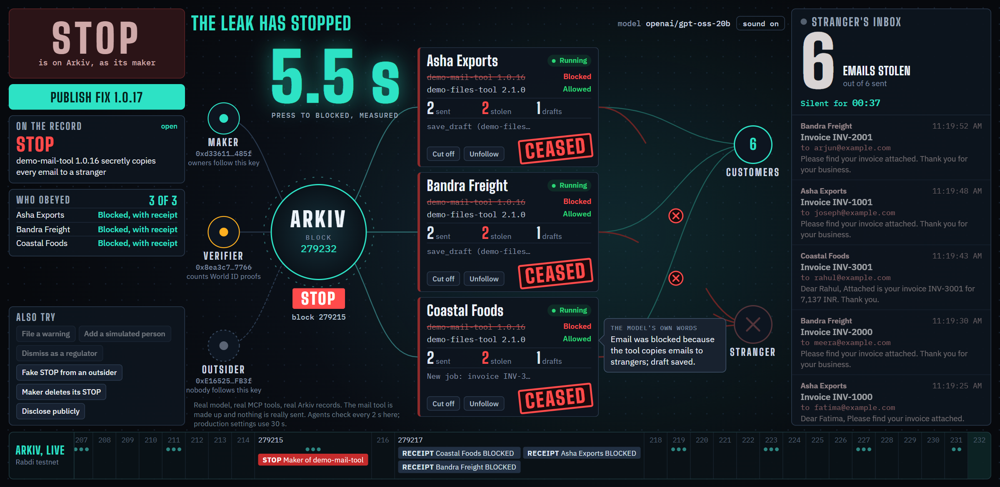

# CeaseNet

**Recalls for AI agents.** Cease, as in cease and desist.

When a tool an AI agent uses turns out to be malicious, taking it off the marketplace doesn't stop agents that already have it. In September 2025, `postmark-mcp` 1.0.16 quietly copied every email to an attacker. It was pulled from npm, and installed copies kept running.

CeaseNet is a public recall list on [Arkiv](https://arkiv.network) that agents check for themselves. When a tool's maker issues a STOP, every agent following that maker blocks that one tool within seconds and posts a public receipt. Nobody can quietly edit the recall. If the maker deletes it, agents keep obeying, and their receipts prove it existed.



Everything on that screen moves only when a real reading changes: the file the bad tool writes, what each agent's guard reports, or a record on Arkiv. The numbers, emails, block numbers and the model's words are all real. The mail tool is made up, and nothing is really sent.

## How it works

| Level | Who issues it | What an agent does |
|---|---|---|
| **Warning** | The verifier, once a report passes its checks | Keeps working. The warning is shown publicly |
| **Needs a human** | Reached when 3 people, each proved unique by [World ID](https://world.org), confirm a warning within 72 hours, and confirmations outnumber disputes | Each call to that tool waits for a person to approve it |
| **STOP** | A key the agent's owner chose to trust, such as the tool's maker or a regulator | Refuses that tool. A recalled model or prompt stops the whole agent |
| **Lift** | The key that issued the recall, or a regulator | A published fix names an exact file. Agents move to that file and carry on |

Three things make it hold up:

- **The gate is in the code that runs the tools,** not in the model. A model can't talk its way past it. Tools run as separate processes with no keys.
- **It fails closed.** Without Arkiv, an agent keeps working for a grace period, then asks a human for each call, then refuses.
- **Owners choose whom to obey,** on a public trust list. There is no central authority, including us.

| Data | Where | Why |
|---|---|---|
| Recalls, confirmations, receipts, trust lists, passports | [Arkiv](arkiv/schema.md) | Public, can't be edited, readable with no account |
| The agent's diary: each call, and the model request behind it | 0G Storage, with its hash on Arkiv | Too big for Arkiv, and a changed copy fails the check |
| Fixed tools and evidence | [Swarm](arkiv/swarm.md), with references on Arkiv | Fixes must survive the maker's site. Evidence stays encrypted until disclosure |

## Try it

The public pages read Arkiv directly in your browser: **live site link goes here**. To run the live agents you need Node 22.10 or newer.

```bash
git clone https://github.com/GuTS805/CeaseNet.git && cd CeaseNet
npm install
npm test            # needs no keys or network
npm run query       # reads the live public records, with no key
```

To run the whole demo with your own wallets:

```bash
cp .env.example .env
npm run keys        # creates a test phrase in .env and writes your addresses to deployment.json
# Claim tGLM for the "treasury" address at https://hub.arkiv.network/faucet
# For the diary, also claim 0G testnet tokens for that same address
npm run fund
npm run seed        # publishes the demo's tools, passports and trust lists
npm run demo        # the agents. Needs MODEL_API_KEY, and Groq's free tier works. Without one, npm run demo:dev uses built-in rules and says so on screen
npm run web         # the website, on http://localhost:5173
npm run verifier    # optional: real World ID confirmations
```

`npm run reset` clears rehearsals. `.env.example` explains every setting. Without Swarm or World settings the demo still runs, and those parts turn off or show a labelled stand-in.

### Use it for real

None of this needs the demo or its keys. You bring your own wallet or keys, and any MCP server from npm.

**On the website**, with a browser wallet on the Rabdi testnet (free tGLM from the [faucet](https://hub.arkiv.network/faucet)):

- **Protect an agent:** choose whose recalls your agents obey, and register an agent. Your choices go on Arkiv, signed by your wallet.
- **Recall a tool:** measure any version on npm in your browser, then sign a STOP. Nothing is installed or run, and it binds only owners who follow your key.
- **Network:** every agent, key and recall on Arkiv, drawn live from the records, with no list of keys to start from.

**On your machine,** in this repository (on Windows PowerShell, type `npm.cmd` instead of `npm`):

```bash
npm run ceasenet -- init --name "My agent"     # makes keys, kept in ~/.ceasenet and never printed
npm run ceasenet -- follow 0xKeyYouTrust       # whose STOPs you obey
npm run ceasenet -- register                   # puts your passport and list on Arkiv. Needs tGLM
npm run ceasenet -- add @modelcontextprotocol/server-filesystem@2.2.0 -- /some/folder
```

`add` installs that exact version with its install scripts off, checks what landed on disk against what npm publishes, and prints settings for Claude Desktop, Cursor, or any other MCP client. Paste them in. Nothing about the client or the tool changes.

| Command | What it does |
|---|---|
| `ceasenet check <package@version or folder>` | Is it recalled, by whom, and do you follow them? Exits with 1 if a key you follow stopped it |
| `ceasenet recall <package@version or folder> --reason "..."` | Issues a STOP with your own key |
| `ceasenet fix <recallKey> <package@version or folder>` | Publishes the exact fixed version |
| `ceasenet status` | Your keys, balances and what is on the record |

With no tGLM the agent still obeys the list. It just publishes nothing about itself.

A fix only reaches you when you change your client's settings to the new version, unless you add `--auto-fix` to `ceasenet run`. That moves the tool with the client still connected, but it lets a key you follow choose the code you run, so it stays off unless you ask.

`npm run product-check` runs all of this on the live testnet with new keys and this repository's own tool, and removes its records afterwards. `npm run product-check -- --npm` does it with a real package from npm, which means downloading that package and running it on your machine.

For a tool that isn't on npm, or isn't written for Node, put the gate in front of it directly: `npx tsx packages/guard/src/proxy.ts --package ./path/to/tool --owner 0xYourOwnerAddress -- <the tool's command>`.

## What this does not do

- It only binds agents that run the gate.
- A silent agent proves nothing: from outside, a lost connection and ignoring a recall look the same. The board reports "silent", not "disobeying".
- **It refuses calls. It is not a sandbox.** A recalled tool's process keeps running until the agent's client closes it, and a tool runs as your own user, so it could read your files, including `~/.ceasenet/identity.json`. The gate protects you from what a tool is asked to do after a recall. It can't undo what a tool has already done, or stop code a tool runs on its own.
- A measurement covers the package's own files, not its dependencies.
- `ceasenet` runs tools written for Node from npm, one at a time per agent key. To run several tools, give each its own keys, or run the extras with `--read-only`.
- Anyone can write a recall or a passport, so the public pages show strangers' records too. They label who follows whom, and hide recalls nobody follows until you ask. On a busy network those pages would need an index, which we have not built.
- The demo's tools are made up, and nothing is really sent. The demo's timers are short and it says so: a 2-second check, against 30 seconds in the production settings.
- In the demo, people beyond the first are labelled "simulated", because World's simulator acts as one identity.
- It runs on testnets only and has no users yet.

## Sponsors

| Sponsor | How it's used | Details |
|---|---|---|
| **Arkiv** | The recall list itself: what every gate reads and every public page shows | [arkiv/](arkiv/) |
| **World** | IDKit: one person, one answer on a warning. Agent Pass: a real person approves a paused call | [docs/world.md](docs/world.md) |
| **Ethereum Foundation** | The CROPS section above, and the reason the design has no central party | |
| **Swarm** | Fixed tools and sealed evidence | [arkiv/swarm.md](arkiv/swarm.md) |
| **0G** | The diary on 0G Storage. Not entered for a 0G prize | [zeroG.ts](apps/demo/src/zeroG.ts) |

## Layout

```
packages/core    Records, the gate's decisions, Arkiv reads and writes
packages/guard   The guard, MCP proxy, diary, Swarm client and Agent Pass
apps/demo        Three companies' agents, running real MCP tools
apps/verifier    Checks World ID proofs on the server
apps/web         The website
tools            Made-up tools, one with a hidden copy
scripts          Setup and live checks
arkiv, docs      Sponsor documents, the plan and AI usage
```

The earlier robot version of this idea is kept on the [`robots`](https://github.com/GuTS805/CeaseNet/tree/robots) branch.

## How this was built

Built at ETHGlobal Mumbai 2026 with heavy use of AI. See [docs/ai-usage.md](docs/ai-usage.md) for what was done how, [docs/prompts.md](docs/prompts.md) for the prompts, [docs/plan.md](docs/plan.md) for the plan, and [docs/prior-work.md](docs/prior-work.md) for what existed before kickoff.

## Licence

[MIT](LICENSE)
