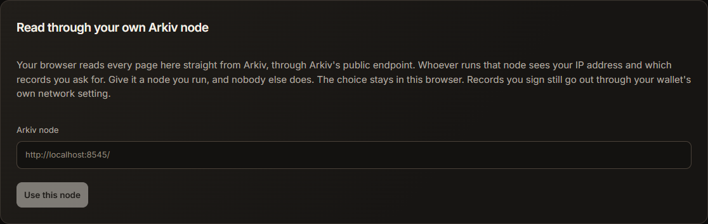

# Privacy: what is public, and who learns what

The short version is in the README's [CROPS section](../README.md#crops). This is the whole of it.

## How much the public list sees

You choose this per owner. A gate decides from what it measured itself, so none of these changes what your agents obey.

| Setting | How | What goes on the public list |
|---|---|---|
| **Open** (default) | Nothing to do | The agent's passport and owner, every tool, model and prompt it runs, its fingerprint, its heartbeat, receipts and the diary index. Anyone can then see who a recall reaches |
| **Private** | `ceasenet privacy private` | Its passport and owner, its heartbeat, a receipt naming a tool only when a STOP covered it, and the diary index. Nothing else about what it runs. Records published before the switch stay until they expire, up to 180 days |
| **Silent** | `ceasenet init --owner <wallet>` on the agent's machine, and never fund the agent's address | Nothing from the agent at all, and it still obeys. Only what the owner's wallet signs itself. There are no receipts to prove it obeyed |
| **This machine** | `ceasenet init --local` | Nothing. Only agents on this machine can obey |

We left Open as the default because a recall's reach can then be counted by anyone, which is what a public recall list is for. The sample agents are open by design.

## Who learns what

| Who | What they learn | How to take it away |
|---|---|---|
| **The Arkiv node you read through** | Your IP address, your owner's address and when you check. Never which tools a gate is checking, because it downloads the whole list | Run your own: `ceasenet rpc <url>`, or the setting on the site's Network page |
| **Anyone reading Arkiv** | What the table above says, and for each login, that this wallet belongs to a person, along with that wallet's votes | Choose a setting above. Logging in is optional: you need it only to open or vote on a recall, or to register an agent through the site |
| **Our verifier** | Your wallet address and a per-action World ID number, when you log in, open a recall or vote. It needs neither to stop your own agents | Run your own from this repository, or don't log in |
| **World** | That a person proved for our action, a hash of your wallet's address that the proof is bound to, and your device's IP address. Not who you are | Don't log in |
| **Vercel, our host** | The IP address of each page load and each verifier call | The Swarm copy, or run the site yourself. Logging in and voting still go through a verifier |
| **npm** | Which package you downloaded, when a gate pins a tool or the site measures one | Measure a copy you already have with `ceasenet check ./folder`, which asks npm nothing |
| **Your model service** | What the sample trading agents ask their model. A client you protect talks to its own model as it always did, and the gate adds nothing | Don't run the sample agents, or use a model you host |
| **Us** | Nothing beyond the verifier row. There are no accounts, trackers or analytics, and CeaseNet keeps nothing in your browser but a node you chose | |

## Tradeoffs we accept

- **Logging in is public.** It links your wallet address to "a person checked by World ID" on Arkiv, and your votes are public under that address. That is what lets anyone recount them.
- **The verifier is one key.** It decides who counts as a person, so a dishonest one could invent votes, but votes stop nothing until the owner approves. It runs as a Vercel function holding only its own key, which can write logins, normal recalls and votes, and never a STOP that binds an agent. Anyone can run their own from this repository.
- **A private agent can't be counted.** A tool recall's page can't show it among the agents covered, and the site can't tell its owner a tool recall concerns them. The console on its own machine still can. An owner's console on another machine sees only who the agent is.
- **Timing is still visible** unless an agent is silent. A heartbeat and a diary index show when an agent is running, though not what it does.
- **"Skip World ID" is off.** It was on (`VERIFIER_ALLOW_BYPASS`) while World App could not finish our request, and let one person log in from several wallets. Those logins stay on Arkiv, marked `unverified-` on the record and on every page, and the verifier no longer accepts them for a vote or a recall. A verifier you run yourself can turn it on again.
- **The public Swarm gateway refuses websites,** so the Swarm copy opens through your own Bee node, such as Swarm Desktop or Nook, at `http://localhost:1633/bzz/b5520ac0997beb6db176034ec5b0774653e543ae6365d4708965ff0eda502842/`. It reads Arkiv's public endpoint, with no access key in it.

## We assume that

- your own machine is not already compromised, as [above](../README.md#what-this-does-not-do)
- the Arkiv node a gate reads serves correct data. A node that hides records can delay a recall, which is why an unreachable list fails closed. One that falls behind or stops is caught, because a gate refuses a list more than 2 minutes old by this machine's clock, but one that hides records while keeping up with the chain is not. The remedy is a node you run, through `ceasenet rpc`
- someone saw a record before it was deleted. Arkiv has no historical reads, so a deleted STOP stays provable only through receipts, gate memory and independent watchers

## Who can read a diary

On Swarm, the whole part is encrypted to your owner key before it leaves your machine, so the table below only applies to parts on 0G. Storage there is public and permanent, and a real agent's calls can hold anything, so who can read the contents depends on the agent:

| Whose diary | What anyone can see | What only the owner can see |
|---|---|---|
| **Your own agents** | What was called, when, what the gate decided, and a hash of the contents | The contents, sealed to your owner key |
| **An agent whose owner's key is elsewhere** | The same | Nothing: the contents are not stored, only their hash |
| **The three sample agents** | Everything | |
| **Any agent kept private** (`ceasenet privacy private`) | Never stored on 0G. A part that can't go to Swarm encrypted stays on your machine, with only its hash and times on Arkiv | Everything |

You can change this with `DIARY_MODE` in your settings (`public`, `sealed` or `hashes`). Each agent stores a part every 2 minutes, and straight away when it closes. A part costs about 0.0013 0G test tokens and takes about 16 seconds, paid by your owner's wallet. Until then it waits in a file on your machine, in the clear, so nothing is lost if the network is out of reach or the wallet is empty.
