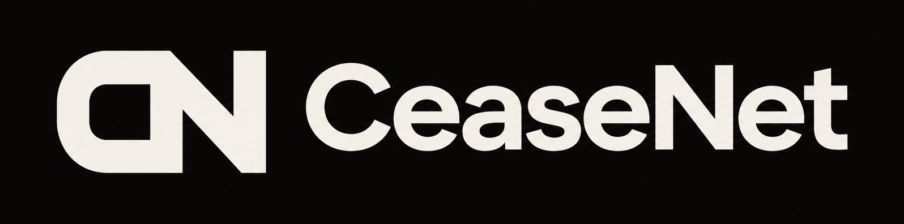

<p align="center">
  
</p>

<p align="center"><strong>Recalls for AI agents.</strong> Stop your agents from anywhere, recall a bad tool everywhere it runs, and see exactly what they did.</p>

`ceasenet` puts a gate between your AI agents and their tools, with no change to either. Before every call, the gate reads a public recall list on [Arkiv](https://arkiv.network). Press Stop, from any machine, and the next call is refused, the agent is told why, and the tool's process is ended.

- **Only the owner counts.** A gate obeys only a STOP signed by its owner's wallet. A STOP from anyone else, the makers of this program included, changes nothing.
- **Nothing of ours is in the path.** Each gate reads Arkiv itself, so a STOP keeps working if our site and server disappear.
- **It fails closed.** If a gate can't read the list, its agent keeps working for 5 minutes, then asks a person before each call, then refuses.

## Start

You need Node 22.10 or newer.

```bash
npm install -g ceasenet

ceasenet init --local      # no wallet and nothing public: everything stays on this machine
ceasenet protect           # puts the gate in front of your agents' MCP servers
ceasenet console           # opens the console at http://127.0.0.1:7787
```

Then restart your agent's client and use it as usual. `protect` finds the settings of Claude Code, Claude Desktop, Cursor, VS Code, Windsurf and Gemini CLI, keeps a copy of each file it changes, and `ceasenet unprotect` undoes it. Drop `--local` to use the public list, which owners can reach from any machine.

| Command | What it does |
|---|---|
| `ceasenet kill --reason "..."` | Stops this agent. `--all` stops every agent you own |
| `ceasenet stop some-tool@1.2.3 --reason "..."` | Recalls one tool on every agent you own |
| `ceasenet lift <key>` | Undoes a STOP |
| `ceasenet check ./folder` | Prints a tool's exact hash, and whether it is recalled for your agents |
| `ceasenet status` | Shows what is protected, whom you obey and what is running |
| `ceasenet help` | Everything else |

It runs on test networks today. The tools it measures, the rules a gate follows, the site, and what this does not do are all in the [full README](https://github.com/GuTS805/CeaseNet#readme).

## Licence

[MIT](https://github.com/GuTS805/CeaseNet/blob/main/LICENSE). The notices of the open-source code bundled into this program are in `dist/THIRD_PARTY_NOTICES.md`.
